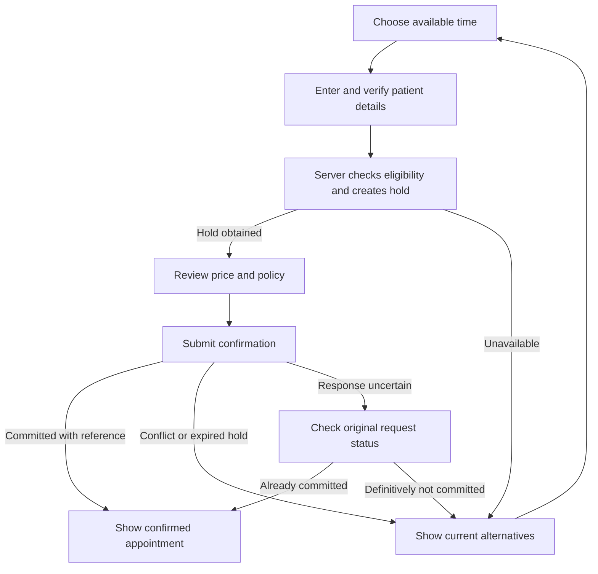

# The Physio Index — Visual Design Specification

**Product:** www.thephysioindex.com  
**Prepared for:** Arun Mahendran  
**Version:** 1.0 · 14 October 2026  
**Direction:** Material Design 3 with selective M3 Expressive styling  
**Scope:** Public website, authentication, onboarding, booking, patient account, physiotherapist and clinic coordinator workspace, super admin and operational staff interfaces.  
**Companion:** The Physio Index SRS 1.0, dated 13 October 2026. This document specifies presentation and interaction; the SRS remains the functional baseline.  
**Status:** Proposed implementation specification. Dimensions, colours and layouts below are TPi design decisions, not claims that Google mandates these exact values.

## Contents

1. [Product and release boundaries](#1-product-and-release-boundaries)
2. [Visual personality and Material approach](#2-visual-personality-and-material-approach)
3. [Brand, colour and typography](#3-brand-colour-and-typography)
4. [Layout, spacing, shape and motion](#4-layout-spacing-shape-and-motion)
5. [Shared component specifications](#5-shared-component-specifications)
6. [Navigation shells and role boundaries](#6-navigation-shells-and-role-boundaries)
7. [Public website pages](#7-public-website-pages)
8. [Authentication and provider onboarding](#8-authentication-and-provider-onboarding)
9. [Booking flow and patient account](#9-booking-flow-and-patient-account)
10. [Physiotherapist and clinic coordinator backend](#10-physiotherapist-and-clinic-coordinator-backend)
11. [Super admin and operations backend](#11-super-admin-and-operations-backend)
12. [Later-release pages](#12-later-release-pages)
13. [States, errors and lifecycle language](#13-states-errors-and-lifecycle-language)
14. [Accessibility and responsive acceptance](#14-accessibility-and-responsive-acceptance)
15. [Content, imagery, notifications and charts](#15-content-imagery-notifications-and-charts)
16. [Frontend implementation and data presentation](#16-frontend-implementation-and-data-presentation)
17. [Design handoff and release checklist](#17-design-handoff-and-release-checklist)
18. [References and decision register](#18-references-and-decision-register)

## 1. Product and release boundaries

### 1.1 What the experience must achieve

Help a patient identify a suitable local physiotherapist, understand the professional's credentials and available services, and book an appointment with confidence. Give physiotherapists an efficient way to maintain their professional presence and schedule. Give administrators clear evidence and controls for approvals, oversight and support.

The experience must accommodate people with pain, reduced dexterity, visual difficulties, limited technical confidence and slower mobile connections. Clarity is a design requirement across all audiences.

### 1.2 Release labels

| Label | Meaning | Interface consequence |
| --- | --- | --- |
| MVP | Launch baseline from the SRS | Fully designed and implemented before launch |
| Conditional MVP | Launch capability with an operational or policy prerequisite | Enable only when the prerequisite is implemented and approved |
| R1 | Growth release | Provide design guidance now; hide routes and controls until enabled |
| R2 | Online payments release | Design separately from pay-at-clinic; no inactive checkout fields in MVP |

MVP includes clinic appointments, instant confirmation, manual bookings, completed-appointment reviews, moderated offers, staff permissions and administration. Home visits, request-to-book, external calendar sync, recurring sessions, richer professional publishing and additional languages are later features. Online collection, refunds and settlements belong to R2.

No patient clinical records, diagnosis interface, prescriptions, treatment-plan editor, social feed or emergency dispatch workflow is included. Administrative appointment notes must not invite clinical documentation.

### 1.3 Non-negotiable distinctions

- A **published listing**, **claimed profile**, **reviewed document** and **checked registration** are separate facts. Their labels must remain separate.
- A published or claimed profile is not automatically bookable. Render booking actions from current eligibility returned by the server.
- A held slot is not a confirmed appointment. Confirmation requires a durable booking reference.
- A completed appointment does not prove payment collection. MVP financial summaries use **booking value** and **payment reported received** where applicable.
- One practitioner may practise at multiple clinics but has one conflict-controlled calendar.
- All sample people, ratings, fees and booking counts in prototypes must be marked as fictional. Never ship placeholder credentials or fabricated testimonials.

### 1.4 Specification notation

Each screen has an identifier and suggested route. Route suffixes beyond the SRS are proposed, not an API contract. Shared templates count as one screen family even when served at many geographic URLs. Modal and drawer flows are named where they are part of a screen; they must receive design frames and tests too.

Every screen inherits the shared accessibility, loading, empty, failure and permission rules in Sections 13–14. Screen-specific exceptions are listed in its entry.

## 2. Visual personality and Material approach

### 2.1 Design statement

**A calm, trustworthy physiotherapy directory with the warmth of a modern care brand and the efficiency of a well-organised scheduling tool.**

Use clear hierarchy, generous public-page spacing, reassuring colours, rounded surfaces and precise feedback. Public pages should feel welcoming. Operational pages should feel organised and fast.

### 2.2 How Material applies

Material 3 supplies the foundation for colour roles, typography, shape, component states and adaptive layouts. M3 Expressive expands that foundation through more varied typography, shapes, colour and motion [R1–R2]. Use selected expressive details to guide attention, without making routine tasks visually busy.

| Area | Expression level | Direction |
| --- | --- | --- |
| Homepage, provider acquisition | Moderate | Strong headings, soft mint sections, authentic photography, rounded search panel |
| Search and profiles | Low to moderate | Clear cards, restrained tonal highlights, visible credentials and availability |
| Booking and account recovery | Low | Consistent steps, stable layouts, explicit errors and simple confirmation |
| Practitioner overview | Low to moderate | One welcoming summary area; practical calendar and action list |
| Calendar, appointments, approvals | Low | Compact hierarchy, meaningful colour, minimal motion, persistent context |
| Analytics | Low | Clear definitions, units, dates and accessible charts |

Keep brand colours stable for all users. Optional light/dark preference can personalise comfort; wallpaper-driven colours are unnecessary for this web product. Dark mode is an R1 proposal unless brought into launch scope explicitly.

### 2.3 Visual guardrails

- Give each region one clear primary action. The full page may contain repeated booking actions when context requires them.
- Use whitespace and typography before adding borders or shadows.
- Use familiar labels such as **Book appointment**, **Manage availability** and **Request changes**.
- Keep decorative shapes outside forms, calendar grids and data tables.
- Avoid glass effects, neon gradients, bouncing controls, animated backgrounds and carousels that hide essential information.
- Never use rating stars, badges or accent colours as substitutes for descriptive evidence.
- Do not visually imitate Google branding. TPi owns its colour palette, logo, imagery and content voice.

### 2.4 Web implementation constraint

At the reference check for this document, Google's Material Web library is in maintenance mode and its web guidance states that M3 Expressive is not implemented on Web [R3–R4]. Treat this as an M3-informed custom web design system. Select maintained accessible interaction primitives and implement TPi tokens and components around them. Do not assume installing a package produces a complete M3 Expressive website.

## 3. Brand, colour and typography

### 3.1 Logo direction

Use the latest TPi concept: navy **T/P** with a teal lowercase **i** that suggests a person stretching. Keep the three letters recognisable. The figure communicates movement and rehabilitation; supporting copy establishes that the product is a directory.

The generated logo is a concept raster, not a production vector master. Before launch, create and review clean SVG paths, a monochrome version, reversed version and favicon variant. Do not reconstruct it using a similar typeface and assume it is the same mark.

| Application | Proposed treatment |
| --- | --- |
| Desktop public header | TPi mark approximately 88–104 px wide, plus readable “The Physio Index” text where space permits |
| Mobile header | Mark approximately 64–80 px wide; accessible home-link name “The Physio Index — home” |
| Backend sidebar | Mark and workspace descriptor; descriptor remains readable when logo is compact |
| Favicon | Simplified, tested small-size variant; retain the recognisable TPi identity |
| Dark backgrounds | Approved light/reversed asset; no automatic colour inversion |

Preserve the asset's proportions. Clear space on all sides should be at least half the lowercase i head diameter. Use a solid light surface behind the primary navy logo. Small-size tests at 16, 24 and 32 px must determine whether the stretching detail needs simplification.

### 3.2 Light-theme colour roles

The values below are proposed production starting tokens inspired by the logo, not sampled or approved final logo colours. Test all real foreground/background combinations, including interaction states.

| Token | Hex | Role / pairing |
| --- | --- | --- |
| `brand-navy` | `#12304A` | Main headings, brand anchors |
| `brand-teal` | `#00A996` | Decorative brand accent; do not use as a white-text button by default |
| `primary` | `#006B5F` | Main action fill and strong interactive accent |
| `on-primary` | `#FFFFFF` | Text/icons on primary |
| `primary-container` | `#D5F5EB` | Selected filters and highlighted care surfaces |
| `on-primary-container` | `#004D43` | Text on primary container |
| `secondary` | `#385D76` | Supporting actions |
| `secondary-container` | `#E2EDF5` | Supporting panels |
| `on-secondary-container` | `#17364D` | Text on supporting panels |
| `surface` | `#FFFFFF` | Cards, dialogs and form bodies |
| `surface-page` | `#F7FAF9` | Main application background |
| `surface-container` | `#EDF3F0` | Grouped sections and backend wells |
| `surface-container-high` | `#E4ECE8` | Stronger grouping, selected neutral areas |
| `on-surface` | `#192C30` | Main content |
| `on-surface-variant` | `#475B60` | Supporting copy and metadata |
| `outline` | `#6D807B` | Required input/control boundary |
| `outline-variant` | `#CDDAD5` | Decorative dividers; not sufficient alone for required control boundaries |
| `focus` | `#1D57B5` | Keyboard focus ring on light surfaces |
| `error` / `error-container` | `#B3261E` / `#FCE9E7` | Failed validation and destructive action context |
| `warning` / `warning-container` | `#795500` / `#FFF0C2` | Pending action or approaching expiry |
| `success` / `success-container` | `#146C43` / `#DDF4E7` | Confirmed successful action |
| `info` / `info-container` | `#174EA6` / `#E8F0FE` | Explanatory and neutral operational information |

Use white text on solid error/success/info fills only after contrast verification. Tonal status badges use the corresponding dark status colour on its pale container. Distinguish statuses by text and icons as well as colour.

Static checks on the proposed solid colours give white on primary approximately **6.43:1**, body text on white **14.54:1**, supporting text on page background **6.82:1**, and the input outline on white **4.18:1**. These checks validate those exact pairs only; gradients, opacity, overlapping surfaces, interactive states and the final implementation still require testing.

### 3.3 Dark-theme proposal — R1

| Token | Hex | Role |
| --- | --- | --- |
| `surface-page` | `#101A1C` | Overall background |
| `surface` | `#172326` | Card background |
| `surface-container` | `#1E2D30` | Grouped content |
| `surface-container-high` | `#29393C` | Raised/grouped contrast |
| `on-surface` | `#E3EFEC` | Main text |
| `on-surface-variant` | `#BCCDC8` | Secondary text |
| `primary` / `on-primary` | `#79D9C5` / `#00382F` | Action fill and label |
| `primary-container` / `on-primary-container` | `#005047` / `#ACF2E0` | Selected regions |
| `outline` | `#829A92` | Control boundaries |
| `focus` | `#ADC6FF` | Keyboard focus |
| `error` / `error-container` | `#FFB4AB` / `#53211F` | Error label and surface |
| `warning` / `warning-container` | `#E9C56C` / `#403216` | Warning label and surface |
| `success` / `success-container` | `#91D5AD` / `#163D2B` | Success label and surface |
| `info` / `info-container` | `#ADC6FF` / `#1B3357` | Information label and surface |

Map every light token before enabling dark mode. Provide **System / Light / Dark** only when all relevant screens and assets have been checked. Never leave documents, logos, maps or charts to untested automatic inversion.

### 3.4 Typography

Use **Roboto** as the default UI typeface with `system-ui, sans-serif` fallback. Use a compatible script-specific font when Indian-language interfaces are enabled. Avoid multiple decorative font families. Typeface files and distribution rights must be included in the implementation asset review.

| Style | Desktop size / line height | Mobile size / line height | Weight / use |
| --- | --- | --- | --- |
| Display | 56 / 64 px | 36 / 44 px | 600; homepage headline only |
| Page heading | 36 / 44 px | 28 / 36 px | 600; public title |
| Workspace heading | 28 / 36 px | 24 / 32 px | 600; backend title |
| Section heading | 24 / 32 px | 22 / 30 px | 600 |
| Card heading | 20 / 28 px | 18 / 26 px | 600 |
| Body large | 18 / 28 px | 18 / 28 px | 400; introductions |
| Body | 16 / 24 px | 16 / 24 px | 400; patient content/forms |
| Operational body | 14 / 20 px | 16 / 24 px where practical | 400–500; dense desktop tables |
| Label | 14 / 20 px | 14 / 20 px | 500–600; controls |
| Caption | 12 / 16 px | 12 / 16 px | 400–500; supplementary metadata only |

Use rem-based implementation and allow text enlargement. Do not put fees, dates, cancellation terms, credential states or form instructions exclusively in captions. Use tabular numerals for times, prices and tables. Avoid all-caps body text. Long names and long translated labels must wrap without losing meaning.

## 4. Layout, spacing, shape and motion

### 4.1 Proposed web breakpoints

These are TPi-specific CSS breakpoints, not a claim of exact parity with Google's current window classes. Adapt to available width and content, not device detection.

| Width | Public layout | Operational layout | Outer gutter |
| --- | --- | --- | --- |
| 0–599 px | One column; inline search; full-screen filter dialog | Single pane; agenda-first calendar; navigation drawer | 16 px, 12 px at exceptionally narrow widths |
| 600–839 px | Wider single column or two simple cards | Drawer or optional labelled rail if content fits | 24 px |
| 840–1199 px | Two main columns where readable | 80 px rail or collapsible 256 px sidebar | 24 px |
| 1200–1599 px | Full directory/profile layouts | Persistent 256 px sidebar and workspace | 32 px |
| 1600 px and above | Centred content, restrained line length | Fluid calendar/table workspace; constrain forms | 40 px maximum |

Public container: maximum 1280 px. Article/policy reading width: 720 px. Standard edit form: 720–800 px. Profile desktop split: main content approximately 2/3, booking rail 340–380 px. Search filters: 256–280 px with remaining width for results. Operational dashboards: maximum 1600 px for overview; calendars and tables may use more available space where useful.

### 4.2 Grid and spacing

Use a 4 px base spacing system: `4, 8, 12, 16, 24, 32, 48, 64, 96`. Default card padding 24 px desktop / 16 px mobile. Form fields have 16–24 px vertical separation. Public sections have 64–96 px desktop / 40–56 px mobile spacing. Backend groups use 24–32 px.

Use 12 layout columns desktop, 8 medium and 4 compact as design aids. Do not force data tables into an arbitrary card grid. Keep labels, content edges and actions aligned consistently.

### 4.3 Shape and elevation

| Element | Proposed radius / treatment |
| --- | --- |
| Search hero panel | 28 px; mint or white surface |
| Public listing and profile cards | 20 px |
| Backend panels | 12–16 px |
| Inputs and standard buttons | 12 px; consistent within a form |
| Filter chips and compact status labels | Fully rounded where width permits |
| Dialogs and sheets | 24 px; compact full-screen dialog may have square outer edges |
| Slot buttons | 12 px; consistent dimensions |

Elevation 0: flat base surfaces. Elevation 1: subtle card separation only where backgrounds cannot do the job. Elevation 2: sticky header or floating booking rail. Elevation 3: dialogs and menus. Use one consistent navy-tinted shadow family; never shadow every nested card. A modal has a dimmed scrim and focus management, not only a shadow.

### 4.4 Motion

Proposed durations: 120 ms for hover/press feedback, 180 ms for chip or tab changes, 240 ms for drawer/dialog transitions. Prefer opacity and small translations. Keep booking confirmation concise and calm. Do not animate numbers or chart bars in a way that delays reading.

Respect `prefers-reduced-motion`: remove translation, scaling, spring motion, smooth auto-scrolling and skeleton shimmer; retain immediate state changes. Layout must not jump when labels, errors or availability update.

## 5. Shared component specifications

### 5.1 Component inventory

| Component | Visual / content contract | Interaction and state requirements |
| --- | --- | --- |
| Primary button | Dark teal fill, white label, 48 px target minimum; 56 px for major mobile booking action | Hover, focus, pressed, pending, disabled; keep width stable; prevent duplicate submits |
| Secondary button | Tonal surface or outline; clear label | Same focus and target behaviour; avoid two filled primary actions side by side |
| Text link | Descriptive text; underline in prose | Keyboard focus; visited style where useful; no colour-only identification in body content |
| Icon button | 20–24 px glyph inside 48 px target | Accessible name; tooltip supplements the name; visible focus |
| Text field | Persistent label, 56 px single-line body, helper/error space | Required indicator explained; inline and summary errors; input preserved after failure |
| Select/combobox | Label plus selected value; distinct option list | Keyboard navigation, no-result state, loading state and disambiguation |
| Location selector | State → city → locality; optional search aliases | Changing parent clears incompatible child with notice; manual entry always available |
| Filter chip | Selected fill, check mark and readable label; count when relevant | Remove/reset action; multi-select semantics; wrapping on narrow screens |
| Status badge | Short text and optional icon; tonal background | Noninteractive by default; colour never the sole meaning |
| Credential label | Exact check type; issuer/check detail through accessible disclosure | No generic “verified doctor” label; hover cannot be the only disclosure route |
| Tabs / section navigation | Clear active indicator and readable labels | Use links for page sections/routes, tab semantics only for actual tab panels |
| Practitioner card | Stable identity, qualification, expertise, clinic/locality, fee basis, next availability, review count | Explicit profile link and booking action; no nested links/buttons inside a whole-card link |
| Offering selector | Service, clinic, duration and total/starting fee | Selection updates valid slots and quote; announce dependent changes |
| Slot selector | Radio-like single selection; date/time labels | Available, selected, unavailable, loading; “selected” does not imply held |
| Appointment card | Date/time first, practitioner/patient by role, branch, status, reference and next action | Cancellation/request state separate from appointment state |
| Data table | 48–56 px rows, sortable headers, numeric alignment and row menu | Pagination, filtered count, empty state, labelled selection; explicit selection scope |
| Queue row | Case subject, type, priority, age, assignee and status | Detail link; overdue text/icon; conflict if another reviewer acts |
| Calendar event | Time, service, patient name where permitted, branch marker, status | Detail opening by keyboard; conflict indicators; accessible agenda alternative |
| File uploader | Drop zone plus normal file button; file purpose visible | Allowed type/size from configuration, progress, scanning, rejected, retry and removal |
| Toast/snackbar | Brief nonblocking outcome | Live region; no sensitive text; critical failures remain in page; undo only if supported |
| Inline banner | Icon, short heading, explanation and relevant action | Dismiss only if nonessential; reconnect/expiry/review requirements remain findable |
| Dialog/drawer | Title, focused task, close/cancel and clearly named action | Focus trap, Escape where safe, focus restore, unsaved-change guard |
| Pagination | Current page and labelled navigation; retain filters | Scroll/focus to results heading; URLs preserve state; no mandatory endless scroll |
| Skeleton / progress | Reflect actual content dimensions | `aria-busy` on relevant region; timeout transitions to useful retry |
| Empty state | Specific explanation plus one next action | Distinguish no data, no matches, no permission and service failure |

### 5.2 Practitioner card anatomy

Desktop: 72–88 px portrait, identity/content column, 200–240 px action column where width allows. Mobile: 64 px portrait beside identity, followed by qualifications, location, price and full-width booking action. Keep all required details visible without opening the profile.

Order: name and designation → qualification/expertise → precise credential label → clinic/locality → rating and review count if present → service fee/duration → next available slot → actions. One card per practitioner; show the best matching branch and a “2 other locations” link when supported. Do not duplicate the practitioner across branch results.

No reviews: show “No appointment reviews yet.” Unclaimed: “Profile not yet claimed”; show **View profile**, with claim entry inside the profile. No bookable slots: show truthful unavailability and alternatives; never invent a time. Display “From ₹…” only with a real qualifying offering and visible fee basis.

### 5.3 Forms and editing

Group related fields under short headings. Keep labels above fields. Mark optional fields in words. Use correct input modes without treating phone, registration and PIN-code values as arithmetic numbers. Errors explain the fix, not just “Invalid input.”

On submission failure, place an error summary above the form, link it to fields and preserve safe input. Sensitive OTPs and files follow their own expiry/security rules. Autosave is appropriate for profile/onboarding drafts; schedule changes, publication and administrative decisions require explicit commit actions.

Show **Saving…**, **Saved at 10:42 AM IST**, or **Changes not saved — retry**. Never show a successful save before the server confirms. Leaving an unsaved form invokes a concise leave/stay dialog. Concurrent edits offer reload/compare rather than silently overwriting.

### 5.4 High-impact actions

Cancellation, suspension, merge, ownership transfer, role escalation, sensitive export and future refund dialogs name the affected person/record, consequences, scope and reason field. Use exact button labels such as **Suspend new bookings** or **Confirm cancellation**. Routine reversible actions must not accumulate unnecessary confirmation dialogs.

Batch actions show selected scope, total affected records, exceptions and individual outcomes. “Select all on this page” and “Select all matching results” are different explicit operations. Disabled actions explain eligibility in nearby text; permission-hidden actions must also be forbidden by the server.

## 6. Navigation shells and role boundaries

### 6.1 Public shell

Desktop header: TPi/home, **Find a physiotherapist**, **For physiotherapists**, **Help**, and **Sign in / My account**. Keep location context near search. Header height target 80 px desktop / 64 px compact. Show full brand name in accessible text even when only TPi fits visually.

Footer: browse locations, about, verification process, help/contact, privacy, terms, cancellation policy and accessibility. Use visible descriptive links. Public browsing does not require an account. No patient account bottom-navigation bar on every public landing page.

### 6.2 Patient shell

Desktop account navigation: **Overview**, **Appointments**, **Family members**, **Reviews**, **Notifications**, **Profile & preferences**, **Help**. Mobile primary destinations: **Find**, **Appointments**, **Account**; secondary account items open within Account. Include notifications in the account header. Do not add Saved until that R1 feature exists.

### 6.3 Practitioner / coordinator shell

Desktop sidebar groups:

- **Practice:** Overview, Calendar, Appointments.
- **Public profile:** Profile, Credentials, Clinics & services, Offers, Reviews.
- **Manage:** Team, Reports, Notifications, Settings, Help.

Only display permitted items. Use a workspace switcher when a user also has a patient or other practitioner role. Keep active practitioner and branch scope visible. Coordinator navigation is a scoped variant of the same shell, not a visually unrelated application.

Mobile primary destinations: **Today**, **Calendar**, **Appointments**, **More**. Use text labels alongside icons. A context-appropriate **Add appointment** button belongs to scheduling screens; no floating universal action obscuring forms.

### 6.4 Administrative shell

Sidebar groups: **Overview**; **Review queues**; **Directory**; **Bookings**; **Support & privacy**; **Analytics**; **Content & master data**; **Access & audit**; **Platform settings**. Show badges only for meaningful actionable counts. The header has current role, scope, notification entry and account menu; global search only searches entities the actor can access.

| Role | Landing view | UI restrictions |
| --- | --- | --- |
| Physiotherapist | Own practice overview | Own public profile and assigned clinical locations |
| Clinic coordinator | Assigned appointments/calendar | Hide credentials, broad analytics and unassigned branches unless explicitly granted |
| Verification reviewer | Assigned verification queue | Evidence and decisions; no patient directory or general exports |
| Support agent | Assigned support cases | Minimum linked booking detail; no silent patient impersonation |
| Analyst | Aggregate analytics | No raw patient identities, credential documents or patient-level drill-down |
| Super administrator | Platform overview | Privileged controls still require scope, reasons, audit and any required second approval |

### 6.5 Shared backend page structure

Use breadcrumbs where hierarchy needs them; title and explanation; primary action on the right; filter bar; content; pagination or completion controls. Keep persistent feedback immediately below the page title. Put record identity and status at the top of detail views, with activity history below the main information.

Mobile details use full pages or full-screen sheets. A desktop split-pane review becomes list → detail → evidence navigation on compact widths; preserve filters and scroll position when returning.

## 7. Public website pages

All pages below are MVP. Specialties initially work as search filters; standalone editorial specialty landing pages are an R1 extension. Geographic pages share a template but have different content priorities.

### PUB-01 — Homepage · `/`

- **Purpose:** Start discovery by location, name or area of practice.
- **Layout:** Public header; two-column hero with search as the dominant element and one authentic physiotherapy image; specialty chips; browse-by-state/city links; three-step explanation; verification explainer; practitioner invitation; footer.
- **Hero content:** “Find a physiotherapist near you.” Supporting copy explains local profiles and available appointments. Search combines a location field and name/specialty field with **Find physiotherapists**.
- **Behaviour:** Manual location is the default reliable path; **Use my location** is optional. Recent location may be retained only according to the relevant preference/consent design. No automatic location-permission prompt on load.
- **Mobile/states:** Stack search before imagery; reduce image height or omit decorative imagery. Failed geolocation leaves manual selection available. Do not show invented profile counts or unverified “best” claims.

### PUB-02 — National directory · `/physiotherapists`

- **Layout:** Title, search, state/union-territory list, available city links and an explanatory directory section. Keep hierarchy understandable without a map.
- **Content:** Geography names and real approved listing counts where returned. A coverage label distinguishes locations with published profiles from locations open for provider registration.
- **Actions:** Choose state/city, search by name, change location.
- **Mobile/states:** Alphabetical grouped list with jump links or search; no horizontal state carousel. Zero-coverage entries explain availability and may link to practitioner onboarding, without implying local care exists.

### PUB-03 — State / union-territory directory · `/physiotherapists/{state}`

- **Layout:** Geographic breadcrumbs; state title; city selection; search results preview or full results; useful location-specific information; related locations.
- **Content:** State-scoped results/count, city navigation and available specialties. Use meaningful editorial copy instead of replacing place names in repetitive paragraphs.
- **Actions:** Choose city, narrow specialty, open profile.
- **Mobile/states:** Cities form a searchable vertical list. Invalid state resolves to a useful not-found page; recognised old slugs redirect to canonical URLs. Empty states offer broader national discovery.

### PUB-04 — City directory · `/physiotherapists/{state}/{city}`

- **Layout:** Breadcrumbs, city heading and search; locality chips/list; desktop filter rail and practitioner cards; list/map toggle when coordinates exist.
- **Content:** One card per practitioner with the branch matching the selected city. Show result count and current sorting. “Bengaluru” and “Bangalore” resolve to the same canonical location rather than separate pages.
- **Actions:** Select locality, date, specialty, language, fee range or verification category; sort by relevance/next available/distance/fee as supported.
- **Mobile/states:** Sticky compact **Filters (3)** and **Sort** actions beneath search; filters open a full-screen dialog with result count and **Show results**. Preserve applied filters and scroll on return from a profile.

### PUB-05 — Locality directory · `/physiotherapists/{state}/{city}/{locality}`

- **Layout:** City template focused on local branch addresses, next availability and nearby alternatives.
- **Content:** Selected locality remains visible above results. Distance appears only when coordinates support it and is described as approximate.
- **Actions:** Open profile, view directions, widen locality or book an eligible offering.
- **Mobile/states:** Empty locality results offer named nearby areas or broader city search. Do not silently expand the search and keep the old heading. A suggested adjacent locality is explicitly labelled as outside the original area.

### PUB-06 — Search and filters · `/search?q=…&city=…`

- **Layout:** Search input and location context; result heading; chips for applied filters; list/map toggle; filter rail; results; pagination.
- **Filters:** State, city, locality, specialty/service, language, clinic mode, fee, availability date and verification category. Radius requires coordinates. Optional self-declared gender filter must preserve an unset category. Future service modes stay hidden until enabled.
- **Behaviour:** Shareable URLs encode non-sensitive search state. Disambiguate duplicate locality names by city/state. Use explicit filter apply on compact screens; desktop updates should not steal focus. Cancel stale search requests and avoid flashing earlier results.
- **Map:** Load progressively. Associate numbered pins with cards, provide keyboard-readable list equivalents and show a selected pin/card together. Map failure does not block the list.
- **States:** Loading preserves dimensions; service failure is not rendered as zero results. Suggest spelling/aliases without overriding the user's choice.

### PUB-07 — Physiotherapist profile · `/physiotherapist/{slug}-{public_id}`

- **First screen:** Breadcrumbs; portrait; name/designation; headline; qualification; location; precise credential labels; rating/count when present; fee basis; next availability; booking rail.
- **Main sections:** Overview and languages; areas of practice; work experience timeline; education; registrations and check details; clinic locations; services and fees; availability; appointment reviews; optional awards, certifications, memberships and publications. Hide empty optional sections.
- **Booking rail:** Select clinic → service → date/slot; show duration, full fee basis, eligible offer and cancellation summary. **Choose appointment** moves into the booking flow. Sticky rail must stop above the footer.
- **Trust:** Registration disclosure shows issuer, jurisdiction, approved public number, check type and date. Membership and enrolment are separate. Private evidence is never part of the public page. A label does not guarantee treatment quality.
- **Additional actions:** Share canonical link, report/correct profile, claim if unclaimed, directions. Do not add unsupported endorsements or followers.
- **Mobile/states:** Identity, location and bookability precede biography. Compact section links wrap or scroll with a visible selected state. Sticky bottom booking action includes fee context and safe-area padding; reserve page space beneath it. Paused/unclaimed/ineligible profiles replace booking with an accurate explanation. Never display an empty interactive slot grid as if booking works.

### PUB-08 — Clinic and branch profile · `/clinics/{slug}-{public_id}`

- **Layout:** Clinic identity and branch selector; location details and photos; practitioners at selected branch; services; accessibility; hours; directions; correction link.
- **Content:** Full address, PIN code, public contact, branch facilities and map if supported. Show clinic affiliation only when approved. Avoid patient-identifiable gallery images.
- **Actions:** Choose practitioner, book that practitioner's offering, change branch, open directions.
- **Mobile/states:** Address and branch are visible before map. Clinic opening hours must not be presented as practitioner availability. An inactive branch cannot accept new bookings; show relevant alternatives without losing context.

### PUB-09 — For physiotherapists · `/for-physiotherapists`

- **Layout:** Clear value proposition; profile/calendar feature previews; create-or-claim action; onboarding steps; verification expectations; FAQ; repeated registration action.
- **Copy:** Explain professional visibility, profile management and appointment tools. Describe launch pricing according to current approved policy; do not promise “free forever” unless adopted explicitly for TPi.
- **Actions:** **Find my profile** first, then **Create a profile** if no match.
- **Mobile/states:** Product previews stack and remain readable. Avoid unsupported usage counts, guaranteed patient acquisition or automated verification promises.

### PUB-10 — Claim discovery · `/claim`

- **Layout:** Profile search by professional name, location and optionally registration details; match cards; selected profile summary; explanation of proof needed.
- **Actions:** **Claim this profile**, **I cannot find my profile**, **Report an incorrect match**.
- **States:** Already claimed, competing claim, no match, search failure and recovery. A shared clinic phone number is not sufficient proof of identity. Keep ownership details private.
- **Mobile:** One match card per row; show branch and qualifications to help distinguish similar names. Authentication occurs before evidence submission, with selected profile retained.

### PUB-11 — Help centre · `/help`

- **Layout:** Search; patient/provider topic groups; popular tasks; contact support link.
- **Content:** Booking, changes/cancellations, profile claims, verification, offers, account access and privacy requests. Use task-based titles.
- **Actions:** Open article, view own booking after authentication, start a support case.
- **States/mobile:** No results offers related topics and contact. Single-column topics on compact screens; help remains accessible without login, although personal cases require identity checks.

### PUB-12 — Help article · `/help/{slug}`

- **Layout:** Breadcrumbs, title, short answer, sequential instructions, related topics and escalation link; maximum 720 px reading width.
- **Content:** Current policy version/effective date when instructions depend on policy. Images supplement real text rather than replacing it.
- **Actions:** Contextual **Manage my appointment** or **Contact support**.
- **States/mobile:** Long steps wrap naturally; no sticky elements covering instructions. Retired articles redirect to current guidance where equivalent.

### PUB-13 — Contact and support intake · `/contact`

- **Layout:** Topic selector; relevant help suggestion; concise form; response expectations; existing-case link.
- **Fields:** Name/contact where needed, category, linked booking/profile if applicable, message and optional safe attachment. Explain that this is platform support.
- **Actions:** **Submit request**; after success show case reference and next step. Do not expose whether another person's booking exists.
- **States/mobile:** Upload/scanning/failure states, submission uncertainty, rate limit and saved reference. Sensitive booking detail moves into authenticated support, not email-like public free text.

### PUB-14 — About · `/about`

- **Layout:** Mission; how discovery works; responsibilities of TPi and practitioners; coverage explanation; contact/onboarding links.
- **Visuals:** Restrained brand treatment and authentic team/product imagery if supplied. No fabricated staff or clinician endorsements.
- **Content:** Clearly describe a directory and booking platform. Do not claim all Indian physiotherapists are listed or verified.
- **Mobile:** Readable editorial layout; one action per section.

### PUB-15 — Verification explained · `/verification`

- **Layout:** Intro; comparison table of credential labels; what is checked; what a check does not establish; correction/report process.
- **Labels:** Registration checked, document reviewed, enrolment identifier, association membership, pending/not independently verified, expired/suspended where appropriate.
- **Actions:** Learn about a specific label from a profile deep link; report a concern.
- **Mobile:** Convert the comparison into labelled stacked items without losing distinctions. Avoid “government approved” or “licensed” claims inferred merely from a platform review.

### PUB-16 — Policies and accessibility · `/privacy`, `/terms`, `/cancellation-policy`, `/provider-terms`, `/accessibility`

- **Shared layout:** Document title, audience, effective date, version, contents navigation, clear sections and contact/request route.
- **Content:** Use approved policy text. Show human-readable booking/cancellation summaries alongside the actual terms; summaries must not invent cutoffs or fees.
- **Actions:** Print, navigate to section, initiate the appropriate privacy/support request.
- **Mobile/states:** Reading width is constrained; wide legal tables reflow. Keep prior versions available only according to publication policy. The accessibility page states measured support and known limitations rather than claiming untested compliance.

### PUB-17 — Report / request profile correction · `/report?profile={public_id}`

- **Layout:** Read-only target profile summary; category; explanation; optional evidence; contact/identity step where needed; confirmation.
- **Categories:** Incorrect professional information, duplicate, unauthorised listing/claim, misleading content and other concern.
- **Actions:** Submit correction/concern and view own case status after authentication.
- **States/mobile:** Do not change the public profile immediately. Show case reference and review expectation. Keep reporting details and uploaded evidence private.

## 8. Authentication and provider onboarding

Use a centred 440–480 px authentication panel on a calm surface. Onboarding can use a 960–1120 px canvas with a desktop step list and an approximately 720 px form. On compact screens show **Step 3 of 7**, current step title and a full-width form. Step counts must come from the actual enabled flow.

### AUTH-01 — Sign in / create account · `/sign-in`

- Role-aware introduction without separate duplicate accounts. Collect mobile number with country context and send OTP. Explain terms/privacy and use of contact information.
- Primary **Continue**; secondary help. Email recovery appears only when supported and verified.
- Retain the intended destination safely after login. Never leak account existence through differing responses. Show rate-limit timing and recovery guidance when applicable.
- No marketing checkbox preselected. Public profile browsing remains accessible without authentication.

### AUTH-02 — Verify mobile · `/verify`

- Show masked destination, **Change number**, one accessible OTP input with grouped visual styling, paste/autofill support and **Verify**.
- Show actual challenge expiry and resend availability from configuration. Do not announce a countdown every second to screen readers.
- Handle incorrect/expired code, resend throttling, delivery delay and attempt limit. Resend must not lose booking context.
- For booking, the slot remains provisional unless the server reports an active hold; authentication must not imply a reservation.

### AUTH-03 — Account recovery / contact change · `/account-recovery`

- Present available verified recovery method or reviewed support flow. For an authenticated contact change, explain proof of old account control and verification of new number.
- Use explicit progress, masked identities and a submission reference. Do not automatically merge accounts sharing a phone number.
- Recovery denial provides a support route without revealing other account details. Preserve existing bookings while the case is reviewed.

### AUTH-04 — Workspace selection · `/choose-workspace`

- Cards for Patient account, named Practitioner workspace and permitted Staff/Admin workspace. Include branch or organisation scope where relevant.
- Default back to last authorised workspace; privileged access may require additional authentication.
- Revoked scopes disappear after session refresh. Show a clear access-changed message if the current workspace is no longer available.

### AUTH-05 — Accept staff invitation · `/invite/{token}`

- Show inviter/organisation, intended role, assigned branches or practitioners and invitation expiry.
- Require the invited identity; **Accept invitation** confirms the displayed scope. Wrong account can sign out and retry.
- Expired, revoked, already accepted and mismatched-identity states have distinct next steps. Do not show unrelated team or patient information.

### AUTH-06 — Privileged authentication · `/admin/sign-in`, `/admin/security/verify`

- Dedicated operational login context with required multifactor setup/challenge and recovery instructions. MFA fields follow accessible authentication rules.
- Recent reauthentication appears for sensitive exports, ownership changes and other protected actions; return to the pending task afterward.
- No sensitive case information on the unauthenticated screen. Session expiry closes private overlays and masks cached patient/evidence content.

### ONB-01 — Existing-profile check · `/workspace/onboarding/find-profile`

- Reuse claim discovery inside onboarding. Search first, choose an existing match or explicitly continue with a new profile.
- Show possible duplicates with name, location and permitted public professional details. Preserve selected identity across login.
- Duplicate indicators require review; no automatic merge. A competing claim displays a case status and pauses ownership transfer.

### ONB-02 — Professional identity · `/workspace/onboarding/identity`

- Fields: professional name/designation, headline, photo, languages, about and contact verification. Use live profile preview beside the form on large screens.
- Explain public versus private fields directly beside them. Photo controls include crop, replace, alternative text and permission confirmation.
- Autosave draft; display completion separately from verification. Required field limits follow the SRS and current server configuration.

### ONB-03 — Qualifications and credentials · `/workspace/onboarding/credentials`

- Repeatable sections for education, statutory registration, enrolment and memberships; collect issuer, jurisdiction, identifier and relevant dates distinctly.
- Private evidence uploader sits within the relevant credential. Explain supported evidence and who can review it. Allow applicable expiry to be omitted where the credential has none.
- Do not force one national registration format or an NMC number. An approved exception path is a review workflow, not a “verified” toggle.
- File states: selected → uploading → scanning → accepted for review or rejected. Upload success does not mean credential approval.

### ONB-04 — Clinics and locations · `/workspace/onboarding/clinics`

- Search existing clinic/branch; request association or create a proposed location. Capture hierarchical address, PIN code, coordinates if available, public contact, hours and accessibility.
- Use a form-first layout with map-pin refinement as optional assistance. Mark home/private contact fields clearly; do not publish them automatically.
- Clinic ownership and practitioner affiliation have different review labels. New locality proposals create review tasks.

### ONB-05 — Services and fees · `/workspace/onboarding/services`

- Offering cards with clinic, initial/follow-up service, duration, slot interval, buffers, price, tax/extra-charge disclosure and effective dates.
- Advanced scheduling settings are progressively disclosed with plain-language explanations. Show how duration differs from blocked time.
- Live patient-facing price preview; **Add another service** is secondary. Validate fees and active windows before continuing. No payment-gateway fields in MVP.

### ONB-06 — Availability setup · `/workspace/onboarding/availability`

- Weekly day rows: open/closed, start/end intervals and branch. Add breaks or additional windows explicitly. Timezone stays visible.
- Preview generated slots by date and offering; show why a day has none. Different-branch overlaps are highlighted because the practitioner has one calendar.
- Use **Copy hours to selected days** with visible targets. On mobile, edit one day in an accessible sheet rather than squeezing a week grid.

### ONB-07 — Preview and submit · `/workspace/onboarding/review`

- Display public-profile preview plus grouped missing requirements and links to fix them. Keep private documents outside the public preview.
- Separate publication-readiness checklist from booking-readiness checklist. Terms/publication consent must identify current versions.
- **Submit for review** creates the case; do not relabel it **Publish**. On success provide reference and status. Submission failure retains the draft.

### ONB-08 — Review status / claim status · `/workspace/onboarding/status`

- Timeline of submitted, under review, changes requested and decision. Display reviewer feedback by section, due action and resubmission control.
- For claims, support requested, evidence requested, under review, approved, rejected and withdrawn. Use the relevant state model rather than mixing it with listing publication.
- Approved publication with incomplete booking eligibility has a clear separate task list. Rejection offers the defined appeal/support route. Do not promise a fixed approval time unless operations can meet the configured target.

## 9. Booking flow and patient account

### 9.1 Booking composition

Desktop: main task column plus 320–360 px appointment summary. Mobile: single column, collapsible summary above fields, clear next action below. Steps are **Choose appointment → Your details → Review → Confirmation**. Authentication can be embedded in the details step or routed through AUTH-01/02.

Show clinic, service and timezone at every time-selection or review step. Back navigation preserves valid choices. Recheck choices changed upstream; do not silently book a different offering or price.

### BKG-01 — Choose service and slot · `/book/{offering_id}`

- Show practitioner and clinic, service/duration, price basis, date picker and available slots grouped into morning/afternoon/evening.
- The date picker has keyboard navigation and an input/list alternative. Show selected date in words; “Today” alone is insufficient.
- Slot controls are at least 48 px targets with visible selected state. Announce availability refresh without resetting keyboard focus.
- No availability: provide next available date, another valid clinic/service or back to search. Never substitute a different provider automatically.
- A selected slot becomes held only after server acknowledgment. Use a real hold-expiry indicator if a hold exists; no artificial urgency.

### BKG-02 — Patient details and verification · `/book/{offering_id}/details`

- Choose **Myself** or an authorised family member; collect name, verified mobile and optional short appointment reason. Show private-field guidance.
- Booking for an adult requires confirmation of authority. Minor booking is conditional on an approved guardian workflow; hide that path when unavailable.
- Keep reason optional, maximum 500 characters per SRS; do not request reports or detailed medical history.
- OTP errors preserve the form. When the slot is lost/hold expires, explain the outcome and take the user back to alternatives without clearing safe account details.

### BKG-03 — Review and confirm · `/book/{offering_id}/review`

- Review practitioner, branch/address, service, date/time, duration, patient, fee line items, applied offer, final amount and cancellation policy.
- Display **Pay at clinic** clearly. The primary action is **Confirm appointment**, not **Pay now**. Offer terms open accessibly and total updates are announced.
- A real hold displays remaining time and recovery options. If price or policy changed, require explicit acceptance of the new quote before confirming.
- Pending request keeps one stable action state. Network uncertainty shows **Checking your booking…** and checks the original request result before offering retry; it must not encourage a duplicate booking.

### BKG-04 — Confirmation · `/account/appointments/{booking_id}/confirmation`

- Show a calm success panel only after durable confirmation: appointment reference, date/time/IST, practitioner, service, clinic address and agreed fee/payment mode.
- Actions: **View appointment**, **Get directions**, **Add to calendar** and relevant management links. Calendar export is not described as live sync.
- If SMS/email delivery fails, the appointment remains confirmed. Explain that confirmation is available in the account without implying a booking failure.
- Refreshing the page retrieves existing booking state; it never submits a new booking. Use an accessible printable layout if printing is supported.

### PAT-01 — Patient overview · `/account`

- Upcoming appointment is dominant; include time, branch, practitioner, status and **View appointment**. Below: recent appointments, pending support/review actions and **Find a physiotherapist**.
- First use: explain that confirmed appointments will appear here and provide discovery entry. Do not fill the dashboard with empty metric tiles.
- Mobile: date/time and management action remain visible without opening multiple panels. If a clinic cancelled, show the cancellation notice with rebooking/support options above normal content.

### PAT-02 — Appointment list · `/account/appointments`

- Tabs/filters for upcoming, past and cancelled; optional reference/name search; cards sorted with nearest future appointment first.
- Each card includes patient/dependant name, practitioner, branch, date/time, service, state and agreed amount.
- Actions are context-sensitive: view, reschedule, cancel, rebook or review only when eligible. Do not show completion-based review actions merely because appointment time has passed.
- Empty filtered result offers **Clear filters**. Mobile uses stacked cards; desktop may use a compact list rather than a dense spreadsheet.

### PAT-03 — Appointment detail · `/account/appointments/{booking_id}`

- Header: status and reference. Main blocks: appointment facts, directions, price snapshot, policy, private details visible only to the booking owner/guardian, and activity history.
- Primary action depends on state; management actions explain cutoffs. Cancellation requests show their own pending status while the underlying appointment remains confirmed until resolved.
- “Rescheduled” belongs in the activity timeline and current slot summary, not as a terminal booking state.
- An unknown/unowned identifier produces a neutral access/not-found response without revealing the patient.

### PAT-04 — Reschedule / cancellation · `/account/appointments/{booking_id}/change`

- Reschedule reuses accessible slot selection with **Current appointment** and **Proposed appointment** summaries. Disclose price/policy differences before **Confirm reschedule**.
- Cancellation shows appointment identity, policy and consequences, then reason where needed and **Confirm cancellation**. After cutoff offer **Request cancellation** with clear pending wording according to configured policy.
- Keep the old booking valid if replacement fails. Show a conflict message and refreshed alternatives. Do not remove the old slot in the UI optimistically.
- On compact screens use a full-screen flow; destructive actions stay apart from routine navigation.

### PAT-05 — Family members / dependants · `/account/family`

- List name, relationship and permitted booking identity; add/edit form in a drawer or page. Collect only necessary attributes.
- Explain adult authority and the conditional minor-guardian process. A checkbox alone must not be described as verified parental consent.
- If guardian workflow is not enabled, communicate the supported booking options without exposing a nonfunctional minor form.
- Removing a relationship requires handling linked future bookings; do not imply historical records disappear instantly.

### PAT-06 — Write and manage reviews · `/account/reviews`

- Show completed bookings eligible for review, submitted reviews, moderation status and any provider response. Use accessible 1–5 radio options with text labels.
- Composer includes chosen public display name and a reminder not to include personal records or another person's details. SRS proposed text limits: 20–2000 characters; actual limits come from configuration.
- Submission feedback distinguishes pending, published, changes required/rejected and appeal. One review per completed booking; no prescription upload as proof.
- No incentives for positive scores. Submitted negative feedback follows the same publication rules as positive feedback.

### PAT-07 — Notifications · `/account/notifications`

- Chronological list grouped by meaningful time period; icon and clear action-oriented title; read/unread distinction includes text/weight, not colour alone.
- Open the current booking state, not an obsolete notification snapshot. Clearly label cancelled/rescheduled events.
- Mark read actions are reversible where supported; failed updates retain unread state. Avoid exposing private appointment reasons in notification previews.

### PAT-08 — Profile, preferences and security · `/account/settings`

- Sections: personal/contact details, verified recovery email if provided, language readiness, transactional channel preferences, separate marketing consent, sessions/security and privacy requests.
- Contact changes use AUTH-03; verified/unverified states are explicit. Transactional and promotional communication have separate labels.
- Sign out is easy to locate. Account deletion starts a tracked privacy workflow and explains effects on future appointments and retained obligations.
- Dark mode controls remain hidden until the R1 theme is implemented; no broken settings placeholders.

### PAT-09 — Support cases and privacy requests · `/account/support`

- List case/reference, linked appointment/profile, category, latest response and state. Detail shows the discussion timeline, attachments, required action and resolution/appeal route.
- Privacy request types include access, correction and deletion as supported; show identity-check status and next steps without inventing legal deadlines.
- Keep attachments private; upload/quarantine errors are visible. Reopened or escalated cases retain their original history.
- Mobile: timeline in one column with a reply composer that does not cover the latest response.

## 10. Physiotherapist and clinic coordinator backend

All screens below are MVP unless a specific subfeature is labelled otherwise. The workspace must remain useful at a reception desk, on a laptop between appointments and on a phone. Prioritise scheduling and unresolved work over decorative metrics.

### PRO-01 — Practice overview · `/workspace`

- **Layout:** Context header with practitioner/branch selector; today's schedule; action queue; four concise metrics; recent booking activity.
- **Metrics:** Confirmed upcoming appointments, explicitly completed visits, cancellations and profile views, each with date basis and refresh time. Booking value may appear with that exact label; never infer revenue.
- **Actions:** **Add appointment**, **Manage availability**, **Edit profile**. Make today's operational action the dominant one.
- **Tasks:** Credential renewal, profile changes requested, affected appointments, delivery failures and unread support replies. Link directly to the relevant record.
- **Mobile/states:** Today and tasks come before charts. New practice onboarding shows readiness tasks; suspended booking eligibility shows a persistent explanation and required action, not an optimistic empty calendar.

### PRO-02 — Combined calendar · `/workspace/calendar`

- **Layout:** Practitioner/branch context; today/previous/next controls; labelled date range; Day / Week / Agenda switch; Add appointment; availability controls. Calendar fills the working area.
- **Events:** Display appointment start/end, patient name if permitted, service, branch marker and state. Show buffer intervals as a distinct neutral hatch/spacing to staff without lengthening the patient-facing appointment.
- **Scopes:** A practitioner sees a combined calendar across branches. Branch filters do not remove cross-branch busy constraints. Coordinators see only permitted detail; conflicts from other scopes appear as generic unavailable intervals if needed, without patient or clinic detail leakage.
- **Interaction:** Click/keyboard opens detail drawer. Selecting a free interval can start manual booking. Dragging/resizing is optional; if implemented, open a review step before committing and provide an equivalent form action.
- **Mobile/states:** Default Agenda or Day. Do not shrink a seven-column week below usability. Show loading, closed day, no bookings, unavailable source, conflict and stale data states. Calendar is never the source of truth for eligibility.

### PRO-03 — Availability rules · `/workspace/availability`

- **Layout:** Branch/offering context; recurring weekly windows; effective dates; service settings summary; generated-slot preview; explicit **Save availability**.
- **Content:** Duration, start interval, buffers, minimum notice and booking horizon are distinct inputs with unit labels. Timezone is always visible. Show precedence of leave/blocks and date-specific overrides using plain descriptions.
- **Actions:** Add interval, copy day, set closed, preview and save. Date-specific empty override explicitly means **Closed this date**.
- **Impact review:** Before saving a reduction, show affected future bookings and how they will be handled. Existing appointments are not automatically cancelled or moved.
- **Mobile/states:** One day/editor panel at a time; no precision dragging required. Version conflict prompts reload/compare; invalid windows highlight exact fields.

### PRO-04 — Leave, blocks and overrides · `/workspace/availability/exceptions`

- **Layout:** Upcoming exceptions list; date range/type filters; **Add leave or block**; drawer with start/end, branch applicability and private administrative reason.
- **Impact:** Show count and scoped list of affected bookings before commit. Create follow-up tasks for unresolved appointments; a block alone cannot silently cancel them.
- **Visual language:** Blocked time uses neutral hatching and “Unavailable”; leave uses a labelled band. Do not reuse confirmed-booking colour.
- **Mobile/states:** Accessible date/time form and list. Multi-day changes show inclusive display dates and exact underlying times. Failure leaves existing availability unchanged and preserves the draft.

### PRO-05 — Appointments list · `/workspace/appointments`

- **Layout:** Reference/patient search; date range and date-type selection; branch, source and status filters; table; pagination; scoped export.
- **Columns:** Appointment time, patient, practitioner if needed, branch, service, source, booking state, agreed amount and row actions. Display patient contact only where needed and permitted.
- **Actions:** Open detail, add appointment, apply permitted status change, request export. Group bulk actions only where the SRS and permissions allow them.
- **Mobile/states:** Convert to appointment cards with date/time, patient, branch and status first. Preserve full detail on open. No matches differs from no appointments. Live changes notify the user without reordering the focused row unexpectedly.

### PRO-06 — Appointment detail · `/workspace/appointments/{booking_id}`

- **Layout:** Reference/status header; appointment and patient summary; service/price/policy; administrative notes; communication delivery; timeline of changes.
- **Actions:** Reschedule, cancel with reason, mark completed after appointment end, mark no-show only after configured grace period, and payment reported received where enabled.
- **State rules:** Show booking state and payment report separately. No clinical diagnosis or treatment-record editor. Notes are clearly labelled **Administrative notes — visible to assigned staff**.
- **Conflicts:** If another actor changed the record, show the new state before a retry. Cancellation/completion must not silently overwrite each other.
- **Mobile:** Main appointment and next action precede history. Sensitive contact is hidden from unassigned roles and not exposed through disabled fields.

### PRO-07 — Manual appointment / walk-in · `/workspace/appointments/new`

- **Layout:** Step/group sequence: scope and offering → patient identity → date/time → price/reason → review. Source selection includes Phone, Walk-in and Staff entry.
- **Patient matching:** Search only within permitted scope. Display enough information to choose a known patient safely; similar/shared contact matches require explicit resolution. New staff-created records do not automatically attach to an online account.
- **Actions:** Confirm authority to enter patient data; select whether transactional confirmation is sent; **Create appointment**.
- **Validation:** Same server conflict, eligibility and patient-overlap rules as public booking. No override switch for double booking. A walk-in still needs a valid appointment interval and supported workflow.
- **Mobile/states:** Full page rather than nested dialogs. Conflict gives alternatives; notification failure does not undo a confirmed appointment.

### PRO-08 — Professional profile editor · `/workspace/profile`

- **Layout:** Section navigation at left; editor in centre; optional public preview at right. Sections match PUB-07: identity, about, expertise, experience, education, registrations, clinics, services, media and optional achievements/publications.
- **Editing:** Repeatable work/education entries with clear dates, reorder controls and accessible alternatives to dragging. Sanitised rich text supports only allowed formatting; no arbitrary embedded scripts.
- **Versioning:** Persistent labels distinguish **Draft**, **Published version** and **Changes awaiting review**. Show **Save draft**, **Preview**, **Submit changes** according to state.
- **Mobile/states:** Section picker above the form; preview opens a separate view. Autosave failure or concurrent editing stays visible. Do not calculate experience by summing overlapping roles.

### PRO-09 — Profile preview and change history · `/workspace/profile/preview`, `/workspace/profile/history`

- Preview reproduces public layout and offers desktop/mobile width toggles. Mark **Private preview** clearly; drafts must not be reachable through public URLs or search engines.
- Comparison shows current published and proposed fields side by side on desktop, stacked with explicit labels on mobile. Use text labels for added/removed/changed fields as well as colour.
- History includes version, actor, timestamp, affected sections and moderation outcome. Prior versions are read-only. Restoration, if supported, creates a new draft instead of overwriting history.
- Private credential files remain outside the public preview even when an administrator opens it.

### PRO-10 — Credentials and renewal · `/workspace/credentials`

- List each credential type, issuer, jurisdiction, permitted identifier, current check result, expiry if applicable and next action.
- Detail separates self-declared data, submitted evidence and reviewer decision. **Upload replacement evidence** starts renewed review rather than toggling a badge.
- Renewal banners identify the actual affected service/eligibility. Unknown or absent expiry is not rendered as an invented expiry date.
- Show booking eligibility separately, with an actionable explanation. Rejected evidence includes reason and allowed resubmission/appeal.
- Mobile uses stacked credential cards; private document viewing requires scoped authenticated access.

### PRO-11 — Clinics and branches · `/workspace/clinics`

- List current, pending and ended associations; each card/table row shows clinic, branch, address, association status and bookable offerings.
- Actions: request association, add proposed branch, edit permitted contact/accessibility details, manage services, end association.
- Branch detail groups address/hours, accessibility/facilities, public media and assigned team. Public clinic hours are labelled separately from personal availability.
- Ending an association previews future appointments and follow-up tasks. Clinic ownership is not implied by creating an association.
- Coordinators see only assigned branches; mobile detail becomes sectioned cards.

### PRO-12 — Services, fees and booking policies · `/workspace/services`

- Offering list shows service name, initial/follow-up type, branch, duration, fee, active dates, state and next availability status.
- Edit form separates patient-facing content/price from scheduling configuration and policies. Include current-versus-proposed effective date and patient-facing price preview.
- **Pause offering** stops new reservations but retains existing booking terms. Existing appointments keep their snapshot fee and policy.
- Show genuine regular fee, disclosed charges and any offer dependence. Block conflicting dates or invalid duration/interval combinations with precise errors.
- Mobile: concise cards; full-screen editor. Future home/online modes stay hidden in MVP.

### PRO-13 — Offers · `/workspace/offers`

- List draft, in-review, approved/scheduled, active, paused, expired and rejected states as derived from moderation plus schedule. Do not compress review approval and activity into one ambiguous flag.
- Composer: title, eligible offerings, fixed/percentage discount, genuine regular price, start/end, minimum spend, discount cap, total/per-patient limits and first-visit condition where supported.
- Preview shows patient price, eligibility conditions and how it appears on profile/booking. Counters distinguish reserved entitlements from redeemed bookings.
- Primary action for new/changed offer is **Submit for review**. Activation/pause applies only when authorised and approved.
- Explain that only one offer applies at launch. Reject outcome guarantees and fabricated strike-through prices through moderation. Existing accepted prices survive later pause.

### PRO-14 — Reviews and replies · `/workspace/reviews`

- Summary uses published eligible reviews; list includes rating, public display name, publication date, review text and reply state. Do not reveal private booking details in public replies.
- Actions: reply through moderated/sanitised composer and report policy violation. There is no delete-negative-review button.
- Show reply preview and privacy reminder. Distinguish unpublished moderation feedback from content already public.
- Mobile cards wrap full review text; “Read more” preserves keyboard context. No empty stars presented as a zero-quality rating.

### PRO-15 — Team and permissions · `/workspace/team`

- List member, role, assigned practitioner/branches, invitation state and last relevant activity where appropriate. Permission summaries use plain language.
- Invite flow shows destination identity, scope, expiry and role preview before sending. Editing scope shows changed access; revocation explains which access ends.
- Use explicit branch/practitioner selection rather than a default “all.” Ownership transfers use the protected admin flow.
- Coordinator users cannot grant themselves access. On mobile, permission groups stack with expand/collapse; don't rely on a giant checkbox matrix.

### PRO-16 — Reports and exports · `/workspace/reports`

- Persistent date range, date basis, branch and source filters; metrics for profile views, booking funnel, confirmed/completed/cancelled/no-show counts, booking value and utilisation.
- Use simple line/bar charts, definitions and an accessible data table. Include numerator/denominator and missing-tracking caveats for rates.
- Display refresh time and scope. Zero, unavailable and not applicable have different representations.
- Export dialog states purpose, filters, columns, permission scope and expiry. Job status is queued/running/ready/failed/expired. Download content must match the selected scope and filters.
- Mobile: one metric/chart at a time; filters in a sheet; tables may scroll within a labelled region where necessary.

### PRO-17 — Notifications and delivery · `/workspace/notifications`

- Combine practitioner-facing updates with actionable delivery issues for assigned appointments. Tabs distinguish **My notifications** from **Appointment delivery issues**.
- Delivery row shows channel, masked recipient, event, state, last attempt and permitted retry action. Show current event/booking version so stale reminders are not resent.
- A failed SMS does not become a cancelled booking. Retries reflect server controls and deduplication; no repeated-send button without pending feedback.
- Mobile: delivery detail in a full-screen sheet; no patient reason or sensitive content in list previews.

### PRO-18 — Practice settings, security and closure · `/workspace/settings`

- Sections: verified contact/recovery, notifications and marketing preferences, public contact rules, calendar display preferences, security/sessions and account requests.
- **Pause new bookings** is separate from listing removal/account closure. Show public copy preview and affected scope before applying.
- Closure flow lists future appointments requiring resolution and any authorised transfer obligations. Provide progress/status rather than promising immediate erasure.
- Display timezone and time format consistently; changing a display preference must not move appointments. Legal/configurable booking rules remain under the allowed policy controls.
- Use destructive styling only for actual destructive consequences. Sign out remains an ordinary visible action.

### PRO-19 — Workspace support · `/workspace/support`

- Reuse PAT-09's case layout with practitioner-specific categories: claim, verification, listing edits, scheduling, offers and account access.
- Link only relevant scoped records; attach evidence with clear private visibility. Include status, assignee/team where useful, latest response and appeal route.
- Credential cases deep-link to the credential record; avoid duplicate document uploads when an authorised existing attachment can be referenced.
- Mobile: case timeline and reply form remain usable with the onscreen keyboard open.

## 11. Super admin and operations backend

The administrator backend is a role-scoped product, not a database browser. Use neutral surfaces, consistent tables and explicit evidence/decision areas. Each review type shares a case template but keeps its own decision criteria and labels.

### 11.1 Standard review workspace

Desktop: 280–320 px queue/context pane, flexible record/evidence pane, 320–360 px decision pane when width permits. At narrower desktop widths use two panes and a decision drawer. Mobile: queue → record → evidence/decision, with persistent case identity and back navigation.

Case header: case ID, type, subject, status, priority, age, assignee and current version. Main content: submitted facts, evidence, current-versus-proposed comparison, relevant history. Decision area: outcome, reason, affected scope, notifications and any required second approval.

Never preselect approval. Rejection/changes-requested require actionable reasons. An expired document link can be refreshed through authorised access. Concurrent reviewer decisions trigger a visible refresh requirement. Private evidence cannot appear in public previews, screenshots for sharing or unsanitised audit text.

### ADM-01 — Platform overview · `/admin`

- **Layout:** Date/scope controls; service health summary; actionable queue counts; booking activity; directory coverage; recent exceptional events.
- **Metrics:** Published, claimed, registration-checked and bookable practitioners separately; confirmed/completed/cancelled appointments; booking value; ageing review cases.
- **Actions:** Open oldest/urgent queues, investigate booking issues, review coverage. Hide metrics outside the role's permission.
- **States/mobile:** Show freshness and partial data failures per panel, not a misleading global zero. Mobile presents urgent tasks first; no wall of tiny charts.

### ADM-02 — Unified review queues · `/admin/queues`

- Queue tabs/filters: new listings, profile changes, claims, credentials, duplicates, offers, reviews, complaints and corrections. Include assignment, geography, age, priority and status filters.
- Rows show subject, type, submitted time, age/overdue indicator, assignee and next action. Age is not a fabricated completion promise.
- Bulk assignment is separate from bulk approval. Selection scope is explicit. Open detail preserves query, pagination and row position.
- A reviewer landing page may default to **Assigned to me**. Reviewer roles do not inherit global patient search.

### ADM-03 — New listing and profile-change review · `/admin/listings/review/{case_id}`

- Compare current approved public version with proposed fields/media. Mark additions, removals and changed sections in words and colour.
- Checklist groups identity, public business details, consent/source, content and separate credential status. Show publication readiness separately from booking eligibility.
- Actions: approve eligible changes, request changes, reject; suspension uses its own impact workflow. Approval displays which field set/version will publish.
- On mobile, switch between **Current** and **Proposed** with stable section anchors; do not make tiny side-by-side columns.

### ADM-04 — Claim and ownership review · `/admin/claims/{case_id}`

- Present existing public identity, claimant details visible only to authorised reviewers, evidence, contact-control checks and competing claims.
- Decision explains exactly which account gains control. An OTP to a newly supplied number is not sufficient proof of existing ownership.
- Competing claims freeze transfer. Sensitive ownership change requires the SRS's recent authentication and independent second approval where applicable.
- Outcome history preserves requester, reviewers, reasons and notifications. Rejection does not delete the underlying listing.

### ADM-05 — Credential verification · `/admin/credentials/{case_id}`

- Three clear groups: claimed credential; official/source evidence; reviewer finding. Show issuer, jurisdiction, credential type, identifier, relevant dates and method of check.
- External source links open safely; document viewer includes zoom, rotate/download only if permitted, file scan result and attachment purpose. Link expiry is recoverable.
- Outcome options must express the actual check: registry/registration checked, document reviewed, unverifiable, expired or other configured result. Do not offer one generic “verified” switch.
- Show public-label preview and booking-eligibility effect before commit. Next review date and reason are recorded where required.

### ADM-06 — Practitioner directory management · `/admin/practitioners`

- Search and filters for geography, listing state, claim state, credential check, booking eligibility and affiliation. Columns show those states separately.
- Detail includes approved profile, drafts, credentials, clinic associations, future-booking impact, cases and audit history.
- Actions: reviewed edit, request changes, suspend/reinstate/archive with reason and permission. Avoid inline editing of sensitive identity fields without version/review context.
- Default table does not expose private contact/evidence. Bulk actions preview affected records and return per-record outcomes.

### ADM-07 — Suspension, reinstatement and affected bookings · `/admin/practitioners/{id}/eligibility`

- Header states current publication and booking eligibility. Decision panel names reason, effective timing, scope and who is notified.
- Impact list shows future appointments requiring resolution, with assigned tasks and outcomes. New booking closure takes effect on the server; the UI shows acknowledgment before claiming success.
- Suspending new bookings does not silently cancel every appointment. Each affected appointment has an auditable resolution.
- Reinstatement shows required checks and unresolved conditions. Keep public messaging neutral and avoid revealing private investigation material.

### ADM-08 — Duplicate review and merge · `/admin/duplicates/{case_id}`

- Comparison columns: identity, credential issuer/identifier, clinic affiliations, source records, ownership and booking history. Highlight matching and conflicting evidence distinctly.
- Choose surviving public identifier explicitly; preview field resolution, URL redirects, source retention and related-record impact.
- No one-click automatic merge of similar names/shared phone numbers. Unresolved ownership or credential conflicts block commitment.
- Require reason and permission. Final receipt states success/failures; preserve histories. Narrow-screen comparison is field-by-field rather than horizontally clipped.

### ADM-09 — Clinics, branches and affiliations · `/admin/clinics`

- Clinic list and branch detail with address hierarchy, ownership status, public contact, facilities, associations and related cases.
- Actions: review ownership/association, approve proposed branch, correct permitted master data, deactivate branch and resolve affected appointments.
- Show clinic ownership separately from practitioner affiliation. Ending an association must not remove historical booking references.
- Duplicate branch candidates link to review. Map/geocoding uncertainty is visible; manual address remains authoritative subject to review.

### ADM-10 — Platform booking oversight · `/admin/bookings`

- Filters: state/city, practitioner, clinic/branch, source, status, date range and explicit date basis. Show results count and aggregate totals before optional record details.
- Patient identifiers are masked by default. **View sensitive details** requires permission and purpose; the purpose is tied to the action/case.
- Detail reuses the appointment facts/timeline layout with actor/source history and administrative correction controls. No silent impersonation.
- Status corrections record reason and preserve original events. Exports are permission- and purpose-scoped. Analyst view stays aggregate-only.

### ADM-11 — Offer moderation · `/admin/offers/{case_id}`

- Show provider, offerings, genuine regular price, proposed discount/total, terms, eligibility dates/caps and patient preview.
- Review checks cover misleading savings, hidden charges, unsupported outcome claims and expired/unavailable offerings. Show moderation state and activity schedule separately.
- Approve, request changes, reject or suspend with reason. Suspension impact explains that previously accepted booking prices remain unchanged.
- Live counters are informational; a stale UI count cannot authorise extra redemptions. Mobile preview uses the same offer card as patients see.

### ADM-12 — Review and reply moderation · `/admin/reviews/{case_id}`

- Display review/reply text, rating, completed-booking eligibility result, public display name and moderation flags. Mask unnecessary patient identity.
- Decisions: publish, request change, reject under stated policy, or escalate. Record reason and appeal path. Negative sentiment is not a removal criterion.
- Preview redactions where policy allows; preserve original privately according to retention policy. Recalculate public rating from published eligible reviews only.
- Support accessible long-text reading; do not force reviewers to inspect screenshots of text.

### ADM-13 — Support, complaints and corrections · `/admin/support`

- Queue columns: case, category, linked object, priority, assignee, age, last response and state. Detail has conversation, evidence, actions and resolution history.
- Categories route to the appropriate team; credential-fraud concerns have urgent triage and suspension-decision links.
- Support-assisted appointment changes identify the staff actor and recorded patient/practitioner authorisation. No invisible account takeover.
- Case closing requires a resolution; appeal/reopen preserves history. Scoped contact reveal and replies use the communication permissions, with no unnecessary bulk export.

### ADM-14 — Privacy and account requests · `/admin/privacy-requests`

- Queue groups access, correction, deletion, account closure and related grievances. Show verified requester, due date from approved policy, state, assignee and blocked dependencies.
- Detail displays identity-verification status, systems/records affected, future-booking obligations, approved retention exceptions and execution status.
- Generate access exports through the protected export workflow. Erasure/anonymisation actions require scoped approval and an impact preview; show partial failure/retry clearly.
- Avoid presenting a simple delete button as complete removal from all backups and downstream systems. Preserve auditable request outcomes without unnecessary retained private content.

### ADM-15 — Analytics and geographic coverage · `/admin/analytics`

- Sections: discovery funnel, booking operations, directory coverage, approval turnaround, cancellations/no-shows and offers. All share explicit date/scope filters.
- Use geographic tables as the primary accessible coverage view; a choropleth is optional and must distinguish no data from zero. Counts refer to real approved entities.
- Definitions appear beside metrics: cohort, denominator, date basis, timezone, refresh time and excluded test accounts. Display small-cohort suppression as **Not shown for privacy**, never zero.
- Drill-down honours role; analysts cannot move from aggregate charts to raw patient identities. Export uses the same definitions and scope.

### ADM-16 — Imports and source review · `/admin/imports`

- Sequence: upload → source/permission metadata → map columns → validate/dry run → duplicate review → staged batch summary → authorised publication review.
- Show total rows, valid rows, warnings, rejected rows and duplicate candidates. Row-level errors link to fields and downloadable error report where permitted.
- Staged imports are private. No bulk “verified/claimed/bookable” mapping field. Source URL, collection date and permitted-use basis remain visible to reviewers.
- Batch detail supports safe correction/reversal of staging changes and clear job progress. Publication is a separate reviewed action; import completion is not public-listing approval.

### ADM-17 — Geography management · `/admin/master-data/geography`

- Hierarchical state/union territory → city → locality browser; search by current name and aliases; detail with canonical slug, status and relationships.
- Actions: approve proposed locality, add alias, correct hierarchy, merge duplicate and deactivate with impact preview. Retain redirects and historical references.
- Never use PIN code as a unique locality identity. Coordinates belong to branches separately.
- Mobile: drill-down list with breadcrumb, not a compressed tree. Bulk updates show relationships and affected discovery pages before commit.

### ADM-18 — Specialties, services and credential authorities · `/admin/master-data`

- Separate tabs for controlled expertise/services, languages, credential types and issuing authorities/jurisdiction rules. Forms use persistent IDs behind readable names.
- Each record shows status, usage count, last change and active versions. Merge/deactivate previews affected profiles/offerings.
- Jurisdiction policy editor distinguishes accepted evidence, public labels and booking prerequisites. Operational/legal approval is recorded before activation; uncertainty is an explicit unresolved condition.
- No global text replacement for credential meanings. Historical bookings retain their original policy versions.

### ADM-19 — Site content, help, SEO and policies · `/admin/content`

- Content list has page type, title, route, owner, draft/published state, effective date and last update. Launch types include help, verification, policies and curated geographic introductions.
- Editor separates body content, navigation/metadata and preview; publication shows changed fields and required approval. Long-form health education is R1 and needs qualified editorial review.
- SEO controls include canonical route and indexability with explanations and safeguards; structured data is generated from validated facts rather than pasted arbitrary claims.
- Public preview excludes private data. Policy versions cannot overwrite the version attached to an existing booking.

### ADM-20 — Message templates and delivery operations · `/admin/notifications`

- Template list grouped by booking confirmation/change/reminder, review invitation, verification and support; language/channel/version visible.
- Editor shows allowed placeholders, sample data clearly marked fictional, masked recipient preview and published version. Separate transactional templates from marketing.
- Delivery tab shows event reference, recipient/channel, queued/sent/failed states, attempts and last error. Retry honours deduplication and current booking version.
- Show partial provider outage without implying booking data loss. Never display actual private appointment reasons or secrets in templates/logs.

### ADM-21 — Users, roles and access requests · `/admin/access`

- List account, permitted role/scope, invitation/security state and active access. Role detail describes capabilities in plain language and maps to permissions.
- Invite/change/revoke actions show scope and consequences. Admin assignment and ownership transfer require recent authentication, reason and independent approval as specified in the SRS.
- Requester cannot approve their own escalation. Pending access is visually distinct from effective access. Revocation status must reflect server/session enforcement.
- Do not expose sensitive patient contact just because the actor can manage staff roles.

### ADM-22 — Audit log · `/admin/audit`

- Read-only filters for actor, action, object, date and correlation/case ID. Columns: timestamp, actor, action, object, reason and outcome.
- Detail shows allowed changed-field summaries, previous/new version references and linked case. Redact secrets and private field values not needed for the audit purpose.
- No edit/delete action in normal application UI. Export remains privileged and purpose-scoped.
- Mobile cards preserve event order; timestamp includes timezone. An empty filter result differs from an audit service failure.

### ADM-23 — Configuration and feature flags · `/admin/settings`

- Groups: booking policy bounds, review targets, notifications, jurisdiction activation, retention/export settings and feature release flags.
- Show current/proposed value, unit, effective date, validation, owner and impact. Distinguish proposed defaults from active policy. Use change preview and audit history.
- Payment/home-visit/online/sync flags carry dependencies; enabling a flag must not bypass unimplemented workflows or server authorisation.
- Keep Neon credentials, authentication secrets and gateway secrets out of this business settings UI. Secret management belongs to authorised deployment infrastructure.

### ADM-24 — Platform health and background jobs · `/admin/operations`

- Restricted operational view: booking/API errors, hold-expiry lag, message backlog, imports, exports, review queue age and backup/restore evidence summaries if integrated.
- Each panel has current value, threshold, freshness and link to the relevant runbook or authorised diagnostic tool. Show “No recent signal” distinctly from healthy.
- Job list supports scoped safe retries with duplicate-protection status; never offer arbitrary SQL execution or unrestricted worker commands.
- Incident banner provides operational impact and update time. Administrative users without operations permission receive no infrastructure or secret detail.

### ADM-25 — Protected export centre · `/admin/exports`

- List request ID, purpose, requester, entity scope, selected columns, filters, created time, expiry and job state.
- Before creation show exactly what can be exported. Require recent reauthentication for sensitive data and omit unnecessary fields by default.
- Ready downloads use authorised short-lived links; expired links offer a new authorised export request, not a permanent public file.
- Show per-job failure and retry without revealing other users' export data. The same component can be reused under practitioner-scoped reports.

## 12. Later-release pages

These screens extend the design language without adding launch commitments. Hide disabled features from navigation and reject their server actions. Do not launch a collection of “Coming soon” controls throughout booking and backend workflows.

### FUT-01 — Home-visit discovery and booking · R1

**Routes:** `/search?mode=home-visit`, offering booking flow, practitioner service-area editor.

- Add a clearly labelled **Home visit** mode, service area, travel fee and service-specific eligibility. Exact patient address is captured privately inside booking, not in public search results.
- Before confirmation, validate coverage, address, travel buffers, total price and available time. A map pin supplements a readable address; provide manual correction.
- Provider view shows the address only to assigned staff after booking. Calendar indicates travel time without exposing patient addresses to unassigned viewers.
- Out-of-area, unconfirmed address and unavailable travel capacity have distinct recovery paths. Do not reuse locality membership as proof of home-visit coverage.

### FUT-02 — Request-to-book, waitlist and recurring sessions · R1

**Routes:** booking mode extension, `/account/waitlist`, `/workspace/requests`, `/workspace/recurring`.

- Request flow uses **Request appointment**, response deadline and a visible **Requested** state. It must never display confirmed success styling before acceptance.
- Provider request queue shows time remaining, patient/service context and approve/decline actions with current availability validation. Expired requests cannot be accepted blindly.
- Waitlist capture specifies acceptable dates/services, consent and notification expectations; joining is not a reservation or treatment guarantee. Provide leave-waitlist control.
- Recurring setup previews each appointment, conflicts, price and cancellation scope. Individual and whole-series actions are visibly distinct; show partial results and avoid implying all sessions succeeded when only some did.

### FUT-03 — External calendar connections · R1 · `/workspace/integrations/calendar`

- Connection cards show provider, authorised account, permission scope, last successful sync and health. Explain busy-time import limitations before connection.
- Use explicit Connect / Reconnect / Disconnect actions. Imported events appear as **External busy** without unnecessary titles or attendee details.
- Sync conflicts create a review task; do not silently cancel TPi bookings. Disconnection explains what happens to previously imported busy intervals under the approved policy.
- Do not label an `.ics` export as connected or two-way sync.

### FUT-04 — Professional articles and educational content · R1

**Routes:** `/articles`, `/articles/{slug}`, `/workspace/articles`, editorial queue extension.

- Article index uses readable titles, topic, author, reviewer where relevant and publication/update dates. Article detail has a restrained 720 px reading column, references and author profile link.
- Editor distinguishes draft, submitted, reviewed and published. Clinical claims need qualified editorial review before publication.
- Avoid interruptive booking pop-ups during health information. A relevant provider-discovery link can appear after useful content.
- Publishing activity must not create an undisclosed paid ranking or imply clinical authority beyond verified credentials.

### FUT-05 — Saved profiles and language settings · R1 proposal

**Routes:** `/account/saved`, language selector/settings.

- Saved practitioner cards show current eligibility/availability, not cached promises. Remove/save controls have clear names and feedback. Add this feature only if approved into R1 scope.
- Language selection uses language names in their own script and preserves page context where translations exist. Missing translations are disclosed rather than presenting mixed untranslated controls as complete support.
- Test line wrapping, type coverage, search aliases and translated service/policy terminology. Dates/numbers remain consistent with the chosen locale and stored timezone.

### FUT-06 — Online-session offering · R1, separately approved

**Routes:** future online offering booking flow and authenticated appointment joining page.

- Show online mode, expected technical requirements, consent and attendance instructions. Provide joining action only after the consultation workflow and provider obligations are approved.
- Video access belongs to an authenticated, time-scoped appointment page; never expose meeting credentials on a public profile.
- Include joining-too-early, provider delay, connectivity failure and support states. Enabling an online offering alone must not imply that a working video service exists.

### FUT-07 — Hosted payment checkout · R2 · `/checkout/{booking_attempt_id}`

- Review page shows service total, due-now amount, due-later amount if relevant, taxes/charges, cancellation/refund policy and remaining hold time.
- **Proceed to payment** opens the approved hosted gateway. Keep TPi booking context visible around the handoff; never collect card numbers, CVV or UPI PINs in TPi forms.
- Return screen uses **Checking payment status** until server-verified confirmation. Browser redirect success is not proof of payment.
- Failed, abandoned, pending and late-success states retain attempt identity. A late payment after slot release goes to reconciliation/refund or patient-approved rebooking; no false appointment confirmation.

### FUT-08 — Patient payments, receipts and refunds · R2 · `/account/payments`

- Payment list shows appointment reference, transaction reference, amount, attempt status and refund status separately.
- Detail includes successful collection, any partial/full refunds, policy and support path. Show downloadable receipt/invoice only according to the approved issuer/tax model.
- “Refund requested,” “Processing” and “Refunded” must reflect actual server/gateway state. Do not promise a bank completion date without a supported estimate.
- Do not replace cancelled appointment state with refunded status; both remain visible.

### FUT-09 — Practitioner payment onboarding and settlements · R2 · `/workspace/payments`

- Restricted financial onboarding uses the gateway's approved process. Display verified/pending/action-needed status without exposing full bank details unnecessarily.
- Financial dashboard distinguishes gross collections, refunds, approved platform charges and net settlements with date basis and reconciliation status.
- Settlement detail shows period, transactions, adjustments, status and masked destination. Amounts derive from financial records rather than appointment completion.
- Financial roles are explicit; clinic coordinators do not automatically gain payment or bank-detail access.

### FUT-10 — Admin payment operations · R2 · `/admin/payments`

- Tabs: payment attempts, unmatched/late events, refunds, settlements and reconciliation exceptions. Booking and payment state stay in separate columns.
- Refund action shows original transaction, refundable balance, requested amount, reason and required approval. Above-threshold refunds use the configured second approval/reauthentication workflow.
- Reconciliation cases display event history, amounts, booking/hold state and resolution actions. Duplicate or reordered gateway events must not duplicate collections/refunds.
- Exports, manual adjustments and settlement details are privileged and audited. No improvised wallet or escrow balance UI.

## 13. States, errors and lifecycle language

### 13.1 Required component states

Every interactive component must specify default, hover where relevant, focus-visible, pressed/selected, disabled with explanation, pending and error states. Every data region must specify loading, populated, empty, filtered-empty, unavailable, stale, permission-denied and retry outcomes where relevant. Not every state needs a separate full page, but every supported state needs a design and test fixture.

### 13.2 Status vocabulary

| Entity / situation | Visible language | Visual treatment / consequence |
| --- | --- | --- |
| Listing draft | Draft | Neutral; private |
| Submitted listing | Awaiting review | Amber/info; private |
| Approved public listing | Published | Neutral/positive; not a credential badge |
| Claimed ownership | Profile claimed | Secondary identity information; not proof of licence |
| Checked registration | Registration checked | Precise credential label with issuer/date disclosure |
| Reviewed evidence only | Document reviewed | Distinct label; no claim of live registry confirmation |
| Association/enrolment | Association membership / Enrolment identifier | Plainly categorised, never relabelled as licence |
| Credential issue | Action needed / Expired / Not independently verified | Exact result and relevant action, without defamatory wording |
| No online booking | Online booking unavailable | Informational; hide slot confirmation action |
| Client slot choice | Selected time | Border/check; not a reservation |
| Server hold active | Time held until … | Actual expiry and clear next action |
| Confirmation request pending | Confirming appointment… | Stable pending button, no success badge |
| Confirmed appointment | Confirmed | Success-tonal badge and reference |
| Cancellation request pending | Cancellation requested | Secondary request label; current booking state still shown |
| Cancelled booking | Cancelled by patient / Cancelled by clinic | Explicit actor; no available-management actions that contradict state |
| Completed booking | Completed | Muted positive; review eligible subject to rules |
| No-show booking | No-show | Neutral/amber operational label; no blame language |
| Offline payment report | Payment reported received | Separate from appointment status and platform revenue |
| Rescheduled appointment | Confirmed; changed time in history | Retains booking ID; not a terminal “Rescheduled” state |
| Payment pending, R2 | Payment pending | Not equivalent to confirmed booking |

### 13.3 Booking interaction map



This diagram describes the interface contract; detailed locking, expiry and idempotency rules remain in the SRS. Status checks may continue while a request is unresolved. Do not interpret a temporary status-query failure as proof that no appointment exists.

### 13.4 Failure and recovery patterns

| Situation | Message direction | Recovery |
| --- | --- | --- |
| No search matches | “No matching physiotherapists in this area.” | Change filters or choose an explicitly broader area |
| Search service failure | “We couldn't load results.” | Retry while retaining query and filters |
| Slot taken | “That time is no longer available.” | Refresh alternatives; retain safe patient details |
| Hold expired | “Your reserved time has expired.” | Choose a current slot; don't discard the whole account form |
| Quote changed | “The appointment details have changed.” | Show old/new price or policy; require acceptance |
| Unknown submit outcome | “We're checking whether your appointment was confirmed.” | Check original request; avoid new duplicate submission |
| SMS/email failed after commit | “Your appointment is confirmed. The message could not be delivered.” | Show reference, account link and supported resend/help |
| Concurrent edit | “This record was updated while you were editing.” | Compare/reload before applying changes |
| Network offline | “You're offline. These details may be out of date.” | Disable server-dependent commit, preserve safe work and reconnect |
| Private file rejected | “This file couldn't be accepted.” | Show configured reason and allowed replacement path |
| Scope revoked | “Your access to this workspace has changed.” | Clear private cached content and return to authorised workspace |
| Export expired | “This download has expired.” | Request a new authorised export |

Errors must be specific enough to act on without leaking hidden accounts, patient details or internal security information. Use a support/reference ID for diagnosis, not a stack trace.

### 13.5 System page families

| ID | Page / route | Visual direction and next action |
| --- | --- | --- |
| SYS-01 | 404 / unknown public route | Calm header, brief explanation, location search and home link; don't pretend a removed profile still exists |
| SYS-02 | Removed or restricted public listing | Apply approved 404/410/limited-page policy; neutral wording; no private investigation detail; offer search |
| SYS-03 | Access denied / session expired | For expired session, sign-in return path; for forbidden scope, workspace/help link; no private record preview |
| SYS-04 | Service unavailable / 500 | Clear affected task, retry and support reference; preserve safe state; no invented confirmation |
| SYS-05 | Maintenance / degraded service | Explain actual affected features, last update and available alternatives; only display an ETA if supplied |
| SYS-06 | Offline / reconnection | Persistent status; stale labels; non-sensitive cached content only; booking checks resume on reconnect |

## 14. Accessibility and responsive acceptance

### 14.1 Accessibility target

Target **WCAG 2.2 AA**, with stronger TPi usability choices where helpful. A design file or component library alone does not establish conformance; test the implemented journeys with keyboard, assistive technology and real mobile devices.

| Area | Requirement | Verification |
| --- | --- | --- |
| Text contrast | At least 4.5:1 for ordinary text; 3:1 for qualifying large text [R5] | Check actual tokens, overlays, hover/selected states and chart labels |
| Controls and graphics | Required control/state cues and meaningful graphics meet 3:1 against adjacent colours where the criterion applies [R7] | Include inputs, selected slots, focus rings, icons and chart marks |
| Touch targets | TPi target: at least 48 × 48 CSS px for principal controls; compact chips keep a suitably sized hit area | Measure click/touch bounds, not glyph size |
| WCAG target distinction | WCAG 2.2 AA target-size minimum is 24 × 24 CSS px with specified exceptions; 48 px is the stronger TPi product rule [R6] | Do not mislabel TPi's rule as the WCAG minimum |
| Keyboard | All tasks work without pointer/drag; meaningful focus order, visible focus, no unexpected traps | Search, calendars, OTP, uploads, filters, review decisions and dialogs |
| Focus visibility | Use a distinct ring, proposed 3 px with 2 px offset; adapt for dark/forced-colour environments | Sticky header/footer and overlays must not hide focused controls |
| Reflow | Support text zoom and reflow down to 320 CSS px without unintended page scrolling [R9] | Readable forms/cards; legitimate two-dimensional table/calendar regions remain contained |
| Screen readers | Semantic headings, landmarks, labelled controls and programmatic errors; polite status updates | Test core flows with a screen reader, not only an automated checker |
| Colour dependence | States use text, icons, pattern or position in addition to colour | Greyscale review of booking, approval and chart states |
| Reduced motion | Remove nonessential motion/shimmer; keep feedback immediate | OS reduced-motion setting |
| Authentication | Permit paste/autofill; do not require memory puzzles without an accessible alternative [R8] | OTP, password manager where relevant, MFA and recovery |
| Dragging | Provide single-pointer/form alternatives to dragging where relevant [R8] | Calendar changes, reordering profile entries and file selection |
| Consistency | Keep help and recurring controls in stable locations; avoid unnecessary repeated entry [R8] | Cross-step booking and repeated backend forms |

Do not announce timer changes every second or forcibly move focus when results refresh. For a new blocking error, move focus to a labelled error summary while preserving the user's data. Return focus to the invoking control when a dialog closes.

### 14.2 Responsive acceptance matrix

| Test width / setting | Required checks |
| --- | --- |
| 320 px / high zoom | Form reflow, no clipped critical text, no unintended viewport horizontal scroll |
| 360 and 390 px | Search, profile, slot selection, OTP, fixed booking action and safe-area clearance |
| 600 and 768 px | Intermediate layout, wrapping filters and sidebar/drawer transition |
| 840 and 1024 px | Two-pane details, calendar rail, no squeezed third panel |
| 1280 and 1440 px | Full profile/search/backend layouts; useful information density |
| 1920 px | Restrained public reading width; operational space used intentionally |
| 200% text enlargement | Labels, summaries and actions remain readable and operable |
| 400% browser zoom | Reflow equivalent at compact CSS width; table exceptions handled locally |
| Landscape phone + keyboard | Fields, OTP and submit actions remain visible; overlays scroll correctly |
| Reduced motion / forced colours | Meaningful states and focus remain perceptible |

When a table needs horizontal scrolling, contain it in a named focusable region with visible overflow cues; don't make the entire page scroll sideways. Offer a record-detail or card alternative where it improves the task. Calendar always retains an agenda alternative.

### 14.3 Sticky and fixed elements

Account for header, bottom navigation, booking bar and `env(safe-area-inset-bottom)` together. On public profile/booking screens, use one dominant bottom action region; avoid stacking three persistent bars. Reserve content space so the last form field and footer remain reachable. When the onscreen keyboard opens, the submit action must not cover the active field or prevent scrolling to errors.

## 15. Content, imagery, notifications and charts

### 15.1 Voice and terminology

Use clear Indian English with short action labels. Public copy says **physiotherapist** and **appointment**. Operational copy may use **practitioner**, **branch**, **offering** and **case** when defined. Avoid technical implementation details in patient flows.

| Prefer | Avoid |
| --- | --- |
| Find a physiotherapist near you | Find India's best physio, unless supported by a defined defensible methodology |
| Registration checked on [date] | 100% verified / Government approved based only on a platform check |
| Pay at clinic — ₹[amount] | Paid / Revenue when no collection was recorded |
| Request cancellation | Cancelled when only a request was created |
| Next available: [date/time] | Available now when based on stale cached data |
| Your changes are awaiting review | Your profile is live immediately after submission |
| We couldn't save these changes. Retry. | Something went wrong, with no useful next step |

Display dates unambiguously, for example `14 Oct 2026 · 10:30 AM IST`. Use `Asia/Kolkata` as the stored display timezone identifier and a clear human label in the UI. Use INR formatting and display paise when present; do not round away a real quoted charge. Preserve registration identifiers and PIN codes as strings, including leading zeros.

### 15.2 Imagery and icons

- Use authentic, permissioned images of physiotherapists and clinics. Public profiles use the actual practitioner image; no synthetic stand-in presented as that professional.
- Homepage photography should include a range of ages and everyday mobility/rehabilitation contexts. Avoid exclusively athletic or bodybuilding imagery that narrows the audience incorrectly.
- Keep clinical scenes respectful, uncluttered and privacy-safe. Obtain appropriate permissions for any patient appearance; never display private certificates as decorative imagery.
- Portrait containers have consistent crop controls and graceful initials placeholders. Clinic photos preserve useful context rather than dramatic filters.
- Use one coherent rounded icon family. Decorative icons have no accessible name; actionable icons do. Do not use a medical cross as a universal credential badge.
- Image dimensions/aspect ratios are reserved before load. Useful alt text describes content; redundant adjacent portrait names may use empty alt text according to implementation context.

### 15.3 Notification presentation

| Event | In-app content | External message direction |
| --- | --- | --- |
| Booking confirmed | Reference, practitioner, time, clinic, amount and management link | Minimal necessary appointment details; no private reason |
| Rescheduled | New time plus clear change history | Current appointment version only |
| Cancelled | Actor-neutral explanation, status and next step | No misleading “confirmed” subject after cancellation |
| Reminder | Date/time, location and manage action | Revalidate live booking before sending |
| Review requested | Link to eligible completed visit | No incentive linked to positive rating |
| Credential decision | Exact result, reason and next action | Private authenticated workspace link |
| Support update | Case reference and action needed | No sensitive attachment content in preview |

Transactional messaging and optional marketing have separate preferences. User interfaces must reflect queued/sent/failed states honestly; a delivery failure is not a booking failure. Notification links lead to authorised current state and do not embed private data in the URL.

### 15.4 Charts and metrics

Use line charts for time series, horizontal bars for categories and clear tables for precise figures. Prefer a small set of purposeful charts over multiple decorative donut charts. Avoid 3D, truncated bar axes, unlabeled units and rainbow palettes. Mark missing data and refresh gaps visibly.

| Metric | Display definition |
| --- | --- |
| Published profiles | Distinct active approved practitioner IDs; claimed, credential-checked and bookable counts remain separate |
| Booking conversion | Confirmed patient-initiated bookings / tracked booking starts for a defined cohort; disclose measurement gaps |
| Completed visits | Explicitly completed appointments in the selected appointment-date period |
| Cancellation rate | Patient/provider cancellations within the defined confirmed-booking cohort; show actor breakdown |
| No-show rate | No-shows / (completed + no-shows), restricted to elapsed appointment times |
| Booking value | Sum of agreed booking amounts for stated statuses and date basis; not collected revenue |
| Utilisation | Booked service minutes / published available service minutes; explain leave/buffer treatment |
| Review turnaround | Median and 90th percentile submission-to-first-decision time |

Every chart needs a title, scope, date basis, units, legend when relevant, keyboard-accessible information and a table equivalent. Tooltip content must be accessible without hover. Suppressed cohorts use a labelled unavailable cell, not `0`.

### 15.5 SEO and public content structure

Public directory/profile pages have one descriptive main heading, meaningful section headings, breadcrumbs and real internal links. Render useful public content in indexable output. Keep essential profile details out of inaccessible canvas widgets or image-only text.

Maintain clear canonical routes when names or locations change. Limit indexable filter combinations to approved useful pages. Booking, account, drafts and admin remain authenticated/private as appropriate; noindex does not provide access control. Structured data must match visible approved facts and must not imply that a physiotherapist is a medical physician solely to pursue rich results.

## 16. Frontend implementation and data presentation

### 16.1 Architecture responsibilities

Neon PostgreSQL remains the structured system of record. The frontend receives authorised public/account/workspace projections from the application backend. Database credentials and privileged queries never belong in browser code. Private documents and images use the storage/access approach defined in the SRS; this document does not change that architecture.

Choose the component implementation after a small technical proof: public server-rendered profile, accessible search/combobox, date/slot selection, data table and calendar agenda. Evaluate maintainability, accessibility, performance and custom token support. Do not promise complete M3 Expressive compliance from an unmodified component package.

### 16.2 Token and component structure

Design foundations define semantic tokens; reusable components consume those tokens; page templates combine the components into role-specific pages. Maintain one token source for colour, typography, space, shape, elevation, motion and density. Components consume semantic tokens rather than hard-coded page colours.

Suggested starter CSS (illustrative, not a complete implementation):

```css
:root {
  --tpi-primary: #006b5f;
  --tpi-on-primary: #ffffff;
  --tpi-primary-container: #d5f5eb;
  --tpi-on-primary-container: #004d43;
  --tpi-brand-navy: #12304a;
  --tpi-surface: #ffffff;
  --tpi-surface-page: #f7faf9;
  --tpi-surface-container: #edf3f0;
  --tpi-on-surface: #192c30;
  --tpi-on-surface-variant: #475b60;
  --tpi-outline: #6d807b;
  --tpi-outline-variant: #cddad5;
  --tpi-focus: #1d57b5;
  --tpi-space-1: 0.25rem;
  --tpi-space-2: 0.5rem;
  --tpi-space-3: 0.75rem;
  --tpi-space-4: 1rem;
  --tpi-space-6: 1.5rem;
  --tpi-space-8: 2rem;
  --tpi-radius-control: 0.75rem;
  --tpi-radius-card: 1.25rem;
  --tpi-radius-dialog: 1.5rem;
  --tpi-target-min: 3rem;
  --tpi-motion-fast: 120ms;
  --tpi-motion-standard: 180ms;
  --tpi-motion-panel: 240ms;
  --tpi-font: "Roboto", system-ui, sans-serif;
}

.tpi-control:focus-visible {
  outline: 3px solid var(--tpi-focus);
  outline-offset: 2px;
}

.tpi-button {
  min-block-size: var(--tpi-target-min);
  padding-inline: var(--tpi-space-6);
  border-radius: var(--tpi-radius-control);
}

.tpi-mobile-action-region {
  padding-block-end: max(1rem, env(safe-area-inset-bottom));
}

@media (prefers-reduced-motion: reduce) {
  :root {
    --tpi-motion-fast: 0ms;
    --tpi-motion-standard: 0ms;
    --tpi-motion-panel: 0ms;
  }
}
```

The implementation must also disable spring/transform motion and shimmer when reduced motion is enabled; setting these variables alone will not control third-party animations. Small-text and focus contrast require testing on the actual adjacent surface.

### 16.3 Required UI data contracts

| Projection | Fields the interface needs | What must not be inferred on the client |
| --- | --- | --- |
| Public practitioner | Stable public ID/URL, approved identity, allowed credentials, branch matches, fees, eligible review summary | Claim status from profile completeness; registration check from uploaded file |
| Bookability | Allowed action, current reason code, allowed offerings, schedule version | Eligibility from a green badge or cached page |
| Available slot | Offering, UTC start/end, display timezone, quote reference, schedule version | Availability from an empty-looking calendar cell |
| Hold | Opaque actor-scoped token, actual server expiry, state | Successful reservation before server acknowledgment |
| Quote | Currency, exact line items, offer eligibility/terms, total, policy/price version | Best discount or financial rounding independently in browser |
| Booking | Durable reference, state, revision, permitted actions, price/policy snapshot, current time/branch | Confirmation from a toast, redirect or message dispatch |
| Review eligibility | Completed-booking relationship and allowed action | Eligibility just because time elapsed |
| Moderation case | State, assignee, version, evidence permissions and allowed decisions | Permission from visible navigation alone |
| Report | Date basis, scope, definitions, aggregates, refresh time and suppression flags | Revenue from booking value; zero from missing data |

API-provided allowed actions improve presentation but do not replace server-side authorisation on every read/write. Client errors map to useful product copy; raw database errors are never shown.

### 16.4 Data and privacy presentation

- Keep patient identity, appointment reasons, credentials and private files out of public HTML, structured data, marketing analytics and error logging.
- Use pseudonymous event identifiers for funnel analytics. A search/profile view/booking start/hold/confirmation are different events.
- Draft autosave storage must be scoped and cleared according to the security design; do not persist private patient data in shared-device browser storage by default.
- Mask patient identity in broad admin views. Reveal only permitted detail for a stated purpose, with audit.
- Preserve quote, policy and booking versions in the interface when historical and current values differ.
- Reset scoped caches and close private overlays after logout, workspace change or access revocation.

### 16.5 Performance and rendering targets

Adopt the SRS's proposed public-page targets: mobile field p75 LCP ≤2.5 seconds, INP ≤200 milliseconds and CLS ≤0.1 when sufficient field data exists; use documented lab checks before launch. These are targets, not measured results for the planned site.

Reserve image/card heights, load maps only when useful, paginate long results and lazy-load below-fold media. Avoid large animation dependencies solely for decorative Expressive effects. Load administrative code separately from public discovery where feasible. Public page rendering and initial readable content must not wait for a heavy calendar widget.

### 16.6 Design-system states in code

Provide a component showcase with real keyboard behaviour and fixtures for long names, no portrait, no reviews, large fees, expired credentials, multiple clinics, zero results, slow responses and rejected uploads. Use fictional fixtures clearly marked in development. Visual snapshots are useful for common components; business transaction tests remain separate and follow the SRS.

## 17. Design handoff and release checklist

### 17.1 Required design deliverables

1. Token definitions and component library for the light launch theme; dark tokens retained as an R1 specification until complete.
2. Responsive layouts for all MVP page families in Sections 7–11 plus system states in Section 13.
3. Detailed frames for homepage, results, profile, slot/details/review/confirmation, practitioner calendar, availability, manual appointment and admin verification/approval.
4. Interaction prototypes for patient booking/change, provider onboarding/renewal, multi-branch scheduling, claim review, suspension impact and staff invitation/scope change.
5. Component state sheets, keyboard/focus notes, form validations and approved copy.
6. Production logo assets, image usage guidance and icon inventory.
7. Accessibility and performance evidence from the implemented product; record remaining issues with owners.
8. Future-feature page designs only when the relevant R1/R2 scope is commissioned; maintain the directions in Section 12 for consistency.

### 17.2 Screen-family coverage register

| Area | IDs | Screen families | Release |
| --- | --- | --- | --- |
| Public website | PUB-01–PUB-17 | 17 | MVP |
| Authentication | AUTH-01–AUTH-06 | 6 | MVP |
| Provider onboarding | ONB-01–ONB-08 | 8 | MVP |
| Booking | BKG-01–BKG-04 | 4 | MVP |
| Patient account | PAT-01–PAT-09 | 9 | MVP, with conditional minor/dependant workflow |
| Practitioner/coordinator backend | PRO-01–PRO-19 | 19 | MVP |
| Admin/operations backend | ADM-01–ADM-25 | 25 | MVP |
| System/error pages | SYS-01–SYS-06 | 6 | MVP |
| Growth and payments | FUT-01–FUT-10 | 10 | R1/R2; FUT-05 is an additional proposal |
| **Total** | | **104 screen families** | Includes shared templates and grouped subroutes, not 104 unrelated custom layouts |

### 17.3 SRS alignment map

| SRS area | Design coverage |
| --- | --- |
| DIR / LOC: geography, search, clinics | PUB-01–08, PRO-11, ADM-09 and ADM-17 |
| IAM: identities, staff and roles | AUTH-01–06, PAT-08, PRO-15, ADM-21, shared role shells |
| PRO / VER: claims, profiles and credentials | PUB-07/09/10/15/17, ONB-01–08, PRO-08–10, ADM-03–08 |
| CAL / BKG: scheduling and bookings | BKG-01–04, PAT-01–05, PRO-02–07/12, ADM-07/10 |
| OFR / PAY: offers and payment boundary | PRO-13, ADM-11, BKG-03, FUT-07–10 |
| MSG: messages and delivery | PAT-07, PRO-17, ADM-20, Section 15.3 |
| REV: reviews, replies and appeals | PAT-06, PRO-14, ADM-12/13 |
| ADM / ANA: operations and analytics | ADM-01–25, PRO-16, Section 15.4 |
| SEO: public structure and visibility | PUB templates, ADM-19, Section 15.5 |
| DAT / API: data and version contracts | Section 16; detailed backend implementation stays in SRS |
| SEC / NFR / OPS: privacy, quality and operations | Role boundaries, ADM-14/21–25, Sections 13–17 |

### 17.4 Acceptance checklist

- [ ] Search works by state, city and locality, including aliases, and does not duplicate practitioners across branches.
- [ ] Every public credential label states the actual check; published, claimed and verified are never collapsed into one badge.
- [ ] Profile identity, price basis, location and availability are readable before long biography content on mobile.
- [ ] A user can complete booking using keyboard alone and with a screen reader.
- [ ] Slot conflict, hold expiry, changed quote and unknown submission outcome all have safe recovery paths.
- [ ] Confirmation only appears after the server returns a durable booking reference.
- [ ] Pay-at-clinic is explicit; MVP contains no online payment collection or fake revenue figures.
- [ ] Rescheduling failure keeps the original appointment, price and policy intact.
- [ ] Cancellation request, confirmed cancellation, completion and no-show use correct separate states.
- [ ] Calendar accounts for cross-branch occupancy, leave and buffers, with a usable agenda alternative.
- [ ] Availability edits, suspension and branch closure show affected future appointments and resolution tasks.
- [ ] Profile draft, published version and submitted change are visually distinct.
- [ ] Private evidence never appears on a public profile or public preview.
- [ ] Coordinator, reviewer, support and analyst screens expose only permitted fields and actions.
- [ ] Claim/merge/ownership/role changes include the required review, reasons and independent approval.
- [ ] Tables, exports and charts use the same scope, date basis and definitions.
- [ ] Every page family has loading, empty, failure, stale and access states where applicable.
- [ ] Colour pairs, keyboard focus, screen-reader labels, target sizes, reflow and reduced motion pass implemented checks.
- [ ] Sticky bars and mobile keyboards never cover required fields, actions or error messages.
- [ ] Notifications report delivery state without changing booking truth.
- [ ] Imported profiles remain staged until reviewed; import does not grant claim/verification/bookability.
- [ ] Later-release routes and actions remain hidden and server-disabled until their full workflow is available.
- [ ] Public pages contain no prototype claims, sample credentials, fake reviews or placeholder statistics.
- [ ] Logo vector, small-size mark, image rights and font distribution requirements are reviewed before release.

### 17.5 Suggested implementation sequence

| Stage | Deliverable | Exit evidence |
| --- | --- | --- |
| 1 — Foundations | Tokens, shells, forms, cards, badges, tables, dialogs | Accessible component showcase and approved brand treatment |
| 2 — Discovery | Home, geographic pages, results, profiles, clinic pages | Responsive public journey with truthful data states |
| 3 — Identity and booking | Auth, claims/onboarding, booking, patient management | End-to-end prototype and implemented conflict/expiry states |
| 4 — Practice operations | Calendar, availability, appointments, profile, offers, team | Multi-branch and coordinator-scope scenarios pass |
| 5 — Administration | Queues, evidence, booking oversight, support, analytics, settings | Reviewer/support/analyst permission and audit scenarios pass |
| 6 — Release quality | Accessibility, content, performance, system states | Acceptance checklist and SRS launch tests signed off |

These are delivery stages, not duration estimates. Estimation depends on team capacity, component choice, integrations and approved release scope.

## 18. References and decision register

### 18.1 Product source

**The Physio Index SRS 1.0 — 13 October 2026**, previously prepared for Arun Mahendran. Read for alignment with launch scope, role permissions, credential semantics, booking lifecycle, offers, administration, Neon architecture and acceptance targets. This visual specification does not silently amend its functional requirements.

### 18.2 External references

Reference check: **14 October 2026**. Material guidance and library support may change; recheck implementation support when selecting dependencies. All page layouts, token values and density choices in this document are TPi proposals.

| ID | Official reference | Use in this specification |
| --- | --- | --- |
| R1 | [Google Material Design 3](https://m3.material.io/) | Overall design-system foundation |
| R2 | [Start building with Material 3 Expressive](https://m3.material.io/blog/building-with-m3-expressive) | Expressive as an evolution/expansion of M3 |
| R3 | [Material Design 3 for Web](https://m3.material.io/develop/web) | Current official web implementation limitation |
| R4 | [Material Web](https://material-web.dev/) | Library maintenance status |
| R5 | [W3C: Contrast Minimum](https://www.w3.org/WAI/WCAG22/Understanding/contrast-minimum.html) | Text contrast requirements |
| R6 | [W3C: Target Size Minimum](https://www.w3.org/WAI/WCAG22/Understanding/target-size-minimum.html) | Distinction between AA minimum and stronger TPi target |
| R7 | [W3C: Non-text Contrast](https://www.w3.org/WAI/WCAG22/Understanding/non-text-contrast.html) | Controls and meaningful graphics |
| R8 | [W3C: What's New in WCAG 2.2](https://www.w3.org/WAI/standards-guidelines/wcag/new-in-22/) | Focus, dragging, consistent help and authentication considerations |
| R9 | [W3C: Reflow](https://www.w3.org/WAI/WCAG22/Understanding/reflow.html) | Zoom, narrow layouts and content reflow |

### 18.3 Decisions to confirm during design review

These decisions do not block using this document as the working design baseline. The proposed defaults are explicit so the team can proceed without inventing policy.

| Decision | Proposed direction | Owner / timing |
| --- | --- | --- |
| Logo production master | Refine the stretching-i concept into tested SVG assets | Brand/design before asset handoff |
| Final palette | Adopt Section 3 tokens after real component contrast checks | Design/frontend during foundations |
| Dark mode | R1; fully test rather than partially enabling | Product/design before theme build |
| Web component implementation | Maintained accessible primitives plus TPi M3 tokens; prove critical components first | Engineering during foundations |
| Pricing claims | Launch policy from SRS; no unapproved “free forever” promise | Product before public copy sign-off |
| Cancellation/hold windows | Use approved configurable SRS defaults; display actual server values | Product/operations before booking release |
| Minor bookings | Enable only with the approved guardian workflow | Product/operations before launch |
| Credential wording and jurisdiction eligibility | Exact check-specific labels and approved policies | Verification owner before jurisdiction activation |
| Offer publishing | Moderated; separate approval and active dates | Operations before launch |
| Health educational content | R1 with qualified editorial review | Product/editorial before publishing tools |
| Saved profiles | Optional R1 addition, not a launch commitment | Product during R1 prioritisation |
| Financial model | Resolve merchant, taxes, invoices, refunds and settlements before R2 | Product/finance before payment design approval |

**End of specification.**


